# mt-centrallog Lite

Self-hosted MikroTik central logging with rule-based threat detection, auto block/unblock, an MNDP network map with switch-port locate and MAC→IP/VLAN host lookup, one-click device WebFig console, device backup/restore (binary and reset-first `.rsc`), per-AP wireless client monitoring, and Telegram + email alerting. Docker Compose, SQLite, single-node.

**Current release: `1.5.669`** — pushed 2026-11-23 · pin with `./update.sh 1.5.669` · schema: **no new migration in this range** (`079_loop_protect_ui_settings` arrived with `1.5.650`) — nothing here changes your tables. This release changed **two images, backend and frontend**: no installer file, no compose file, no `.env` key, nothing that writes to a router, so upgrading from `1.5.666` or `1.5.667` needs **no `--refresh`**. ⚠ If you are coming from **`1.5.665` or older**, add `--refresh` once — `1.5.666` moved `install.sh`, `update.sh`, `docker-compose.yml` and added `host_facts.sh` (see the ⚠ note below the feature list). What this release is about, in one line: **every cable between two devices is now drawn as its own line and labelled on its own line** — the map kept one line per device pair, so a dual-homed pair's second wire was invisible, and once the cables were separated their labels still printed on top of each other. Everything from `1.5.667` and `1.5.666` is still in this build: the storm gate's percentage is a slider with a true description, the box measures its own LAN instead of remembering what you typed, the app stopped treating its own polling traffic as an attack, a poller reconnect stopped being read as a router reboot, and the Loop Storm settings page was rebuilt around the fact that several of its numbers only mean something next to each other.

- **Every physical cable between two devices now gets its own line.** The map kept one line per device pair, so a switch dual-homed to the same core with two wires drew one line while its card listed both uplink ports — the second cable was invisible, not merely unlabeled. Each cable is now proven from the devices' own evidence before anything is drawn: either both ends' LLDP tables name the same pair of ports, or a spanning-tree root / alternate / backup port names a designated bridge that belongs to exactly one managed device **and** its designated port number matches that device's stored port number. Anything ambiguous is refused and counted rather than guessed — a wrong cable on the map is worse than a blank one.
- **Each cable carries its own speed colour.** A stroke can show one rate, so cable A running 300 Mbps and its idle twin now get separate lines; one merged line would state a rate no cable actually carries.
- **Each cable labels its own line.** The label rides the curve it belongs to, at a position that alternates near and far and walks further out as more cables are added, so a four-cable trunk stays readable instead of stacking one label over the next. Every label names the ports of **its own** cable and the evidence that proved it — LLDP from both ends, a spanning-tree BPDU, or both — and a label never borrows another cable's port name.
- **The limits are stated, not silent.** At most 6 cables are drawn per device pair, and when more exist the node card says how many. A port the device itself reports down can never become a drawn cable.
- **Nothing in this release writes to a router or changes your data.** It is a map-presentation and evidence-labelling change: the frozen before/after comparison on one stored snapshot showed no node lost, no link added and no link removed — the only difference is what the map draws for a pair that genuinely has more than one cable.

**Carried from `1.5.667` and `1.5.666`, in detail:**

- **The storm gate's percentage is a slider now, and its note says what it does.** `LOOP_GUARD_STORM_RATE_PCT` is the **cap** the app writes into a protected switch port's hardware storm control — the share of that port's own rate that broadcast, unknown-unicast and unknown-multicast frames may use while a storm is declared (1–100; `100` = unlimited; default 5, against this fleet's measured normal load of under 1 % of a port's rate and a real storm that reached 30 %). Two things were wrong about it on **Admin ▸ Loop Storm**. The page's slider list named `storm_rate_pct` and `protect_recheck_max` — **settings that do not exist** — so the real field never got a slide, and it was also folded into the group's extra-settings list, behind a "Show 1 more settings" line. And the sentence beside it said the number was a load a port had to *reach* before the gate armed it, which is the inverse of a cap. It now sits beside its own switch as a slide plus an exact number with a caption naming the control it feeds, and a new test refuses any slider name the page does not declare. **The value, its bounds and its behaviour did not change** — its presentation and its explanation were wrong.
- **A box that moves now measures its own LAN instead of remembering it.** Six settings describe *where this server is*: the interface, subnet, gateway and static address range the neighbour listener uses (`MNDP_PARENT_IFACE`, `MNDP_SUBNET`, `MNDP_GATEWAY`, `MNDP_IP_RANGE`), the address list on the HTTPS certificate (`TLS_SAN`), and the address a router is told to fetch its configuration backup from (`BACKEND_FETCH_URL`). Every one of them was typed by hand — so this portable box, plugged into a different network or handed a new lease, kept describing the OLD one, and each stale value failed invisibly: the certificate named an address nobody types, a device fetch pointed at a host that no longer exists, and the listener's virtual interface landed on a subnet nothing routes on. Deploying or starting the stack now **measures the LAN first** — the interface the default route actually uses, its subnet, its gateway, this host's own address — writes those answers into `./host_facts` (read-only, mounted into the proxy, the backend and the poller), and then **repairs any of those six settings that disagrees**: `.env` is copied to a temporary backup first, a value that already matches is left byte-identical, and a stale backup-fetch address is rewritten before a router is ever sent to it. The certificate **adds the current address to its own list**, and a host with no detectable LAN **changes nothing at all** rather than guessing a subnet. `TLS_SAN_AUTO=false` and `BACKEND_FETCH_URL_AUTO=false` restore exactly the hand-typed behaviour.
- **The app stopped filing itself as its own attacker.** A router's log records our polling traffic by the address that traffic arrives **from**, and the self-check only knew the address our own container routes **through** — on a bridged container network those are different numbers, so this server appeared in its own Threats list under **Router Login Failure**, **PPTP Connection Flood** and even as an AI **brute-force campaign**, next to a Block button that would have pushed a firewall DROP rule for the monitoring box onto a router and cut off its own management path. The protection is now **one rule**, built from what each installation already states about itself — the addresses in `PROTECTED_IPS`, the certificate's own `IP:` entries (`TLS_SAN`), the address routers fetch firmware and backups from (`BACKEND_FETCH_URL`), the address alert links point at (`FRONTEND_BASE_URL`) — plus this host's own network interfaces, plus the part that needs no configuration at all: the log lines its **own routers write when they log in to it**, `user … logged in from <address> via api`. Two devices agreeing is proof, one is not; a **failed** login is never counted, because a failure names an address somebody else typed; only private addresses qualify. The values stated in the configuration still win wherever they name the same address — this is an added tier, never a replacement. Every refusal now says **which setting** recognised the address, printed once per address-and-rule instead of per log line, and both services print the whole set at startup so a moved box or a stale address is visible before it turns into a threat list. `HOST_IP_LOG_ENABLED=true` stays the switch for an operator who *wants* their own server monitored as a source.
- **A poller reconnect is no longer read as a router reboot.** A switch's log numbering starts over every time our poller reconnects, and the old rule read that as "the device forgot everything" and deleted the log history stored for that switch. The numbering is now compared against the boot it came from: stored entries are replaced only when this boot can be shown to supersede them, the deletion is limited to rows that arrived during that boot, and every replacement records **which kind of reset** it was — one the poller watched happen, one it missed while the device was unreachable, a live entry replacing an older boot's row, or a boot it could not date. A genuine reboot still refreshes that switch's history instead of duplicating it. The health sweep reads the **same list of names the code writes** instead of keeping its own copy, so a purge that names nothing is reported as unreadable rather than counted as zero.
- **The Loop Storm settings page was rebuilt, because several of its numbers only mean something next to another one.** The page carried 16 settings; each group now opens with its **switch** — the decision that makes the rest of that group do anything at all — then the controls that decide what counts, and the numbers a site sets once sit behind a **Show N more settings** line that still counts them as changed and still saves them. Related pairs are drawn on **one graduated track** with a handle per value: a protected port's **re-check interval against its disable time** (span 5 s to 24 h) and the **check cycle against its look-back** (5 min to 4 h), the dependent handle stopping at the other, the span past the limit marked as not allowed, and a box under each handle taking the exact duration you type — `1d` is stored as `86400s`, the same grammar the router holds. The numbers under a bar now sit **exactly where a handle of that value sits**, and the axis is divided into durations a person actually writes (5m · 10m · 15m · 20m, or 1h · 2h · 3h) instead of one quarter of the axis, which used to print `375s` under a handle on a 25-minute axis and `15m` under a 10-minute look-back on a 20-minute bar. A contradiction is **refused with its reason named** instead of quietly rewriting a number you typed (an alarm bar cannot be dragged past the number of devices this site has, and the field says which value is setting the limit); a control whose value is fixed by another setting is shown as fixed rather than as a slide every save would undo. Every changed field gained a **reset** link and every group a **Reset to defaults (N)** button — both put the shipped default back into the form and mark it changed, and nothing reaches the switches until you press Save.
- **The storm watch now reads back at least as far as it runs — measured, not assumed.** The watch ran every 15 minutes but looked back only 10, so 300 seconds of every cycle sat outside **any** assessment window. Replaying this fleet's biggest storm of the week (2026-11-19) against all 15 possible cycle start times: the blind stretch held **425 looped-packet rows across 73 devices**, **19 devices were invisible to every window**, and one start time scored the whole episode 21 rows on 2 devices — under both alarm bars, so the storm could have been missed purely by luck of where the cycles happened to land. The look-back is now at least as long as the cycle (both default 15 minutes, so a fresh install covers every cycle); lowering the check period re-sets a stored look-back to the widest value the new period allows and raising it lifts the look-back with it, the save names the number that landed and in which direction, and the page prints how many minutes of every cycle a deliberately shorter look-back leaves unread.
- **A data-centre host is no longer scored as an anonymiser, and a failed lookup explains itself.** The geography lookup mapped the provider's "this is a data centre" answer into the proxy flag. Those are different claims: a hosting provider says where a server lives, a proxy says someone is masking their own address. On one box **4,040 of 6,256** cached addresses carried the proxy flag and **3,390** of them had it from the data-centre answer alone — **165 logged threats were scored with the +15 anonymiser component on that basis**, against 35 that genuinely reported a proxy. The flag now comes only from the proxy answer, so a scored threat says something true about the source, and the hosting identity is still shown in the ISP and ASN columns. A lookup that fails now names **why** — the exception class and the 5-second budget it spent, where 31 production failures previously logged an empty reason — and an address whose lookup just failed is held out of the queue for ten minutes instead of being retried on every threat, which is what keeps the free lookup service under its rate limit.
- **An alert that could not be delivered now says why.** A Telegram alert that failed was recorded with an **empty reason**: the HTTP library this app uses names its connection failures with no message at all, so the log line said only that something went wrong and left the cause blank. Every alert failure now records the failure class alongside the message and writes `no message` when there genuinely was none — so a missing alert is diagnosable from the logs instead of guessed at, and a network problem is told apart from a rejected request.

The `1.5.630`, `1.5.631`, `1.5.632`, `1.5.634` and `1.5.650` work is still in this build; each is one row in the table below.

GHCR `:latest` == `1.5.669`: `backend b8b0b084…` · `poller 451be40e…` · `frontend 2ffe83b3…` · `nginx 09c6191b…` · `mndp-relay a3f7acf1…` (read back off the registry anonymously on 2026-11-23; `:1.5.669` and `:latest` are the **same digest** on all five, and every package now lists **56 tags**). Three of the five carry **the identical digest they had at `1.5.667`** — `poller`, `nginx` and `mndp-relay`: no file in any of those trees moved since the previous publish, so each is a **retag, content unchanged**. That claim was tested, not assumed: `git log` between the two publishes names no file under `lite/poller/`, `lite/nginx/` or `lite/mndp-relay/`, and the baked copies were md5-compared inside the pushed images first (`/app/app/poller.py a6e8cab2…`, `nginx -v` still `1.31.9-alpine` with `/etc/nginx/conf.d/default.conf 45ff8445…` and `/entrypoint.sh 4bb50f9e…`, the relay's `/app/app.py` still `d7d242bf…` — `mndp-relay` keeps the digest it has carried since `1.5.631`). The two that moved are **backend and frontend**, built on the box from a tree md5-identical to the source (**341 files, 0 differing / 0 one-sided**): the baked `/app/app/routers/topology.py dcb01af0…` equals the source, its `_parallel_cables` definition and call site and the `cableCount` payload key all present, `import app.main` clean, no stray directories; the frontend entry bundle is `/assets/index-CE4oaIn_.js` with `data-cable-index` in 1 chunk and the new changelog bullet in 1 chunk, and the Full-only markers (`firmware.bulkAction`, `rules.bulkApprove`) correctly **absent**.

⚠ **`1.5.666` moved the installer files** — `install.sh`, `update.sh`, `docker-compose.yml` (a new read-only `./host_facts:/etc/mtc-host-facts:ro` mount on the backend, the poller and nginx) and a new `host_facts.sh`. **`1.5.669` moves none of them**: it changed the backend and frontend images only, so upgrading from `1.5.666` or `1.5.667` needs **no `--refresh`**. Coming from `1.5.665` or older, run **`./update.sh 1.5.669 --refresh`** once: `--refresh` re-downloads the compose file and the helper scripts, and `update.sh` fetches `host_facts.sh` and runs it even without the flag. Skip `--refresh` and nothing breaks — the containers fall back to the addresses `.env` already states, and the auto path stays inert until the compose file is refreshed. No new tables in this range (migration `079` came with `1.5.650`), and every new `.env` key ships commented-off with a working default. Nothing in this release writes to a router — the storm controls it presents stay opt-in (`LOOP_GUARD_ENABLED` / `LOOP_PROTECT_ENABLED` = `false`).

**Previous releases, in short:**

| Version | What it fixed |
|---|---|
| `1.5.669` | **Every cable between two devices is drawn as its own line, with its own label** (carries the `1.5.668` backend half, which was never published on its own). The map kept one edge per device pair, so a dual-homed pair's second wire was invisible while the node card listed both of its ports; each cable is now proven from the devices themselves — both ends' LLDP naming the same port pair, or a spanning-tree root/alternate/backup port naming a designated bridge owned by exactly one managed device **and** a matching designated port number — and ambiguous claims are refused and counted rather than guessed. Each cable then gets its own labelled edge at a distinct offset with its own speed colour, capped at 6 per pair (the card states how many more exist); a port the device reports down can never become a cable, and no cable borrows another cable's port names. Backend + frontend images only; writes nothing to a router and changes no stored data. |
| `1.5.667` | **The Loop Storm page's storm-control percentage is a slider, and its note was inverted.** `LOOP_GUARD_STORM_RATE_PCT` is the cap written into a protected switch port's chip storm control — the share of that port's own rate that broadcast, unknown-unicast and unknown-multicast frames may use while a storm is declared (1–100, `100` = unlimited, default 5). It was left off the page's slider set because that set named `storm_rate_pct` and `protect_recheck_max`, which are not settings at all, and the field was folded behind a "Show 1 more settings" line; the sentence beside it described a load a port must reach before the gate arms, the inverse of a cap. It now sits beside its own switch as a slide with an exact number and a caption naming what it gates, and a new test refuses any slider name the page does not declare. Value, bounds, defaults and behaviour unchanged — the presentation and the wording were the bugs. |
| `1.5.666` | **A box that moves measures its own LAN instead of remembering it** — the six settings that describe this server (`MNDP_PARENT_IFACE` / `MNDP_SUBNET` / `MNDP_GATEWAY` / `MNDP_IP_RANGE`, `TLS_SAN`, `BACKEND_FETCH_URL`) are re-derived from the host's own routing at deploy/start, `.env` is backed up first, only a disagreeing value is rewritten, and a host with no detectable LAN changes nothing (`TLS_SAN_AUTO` / `BACKEND_FETCH_URL_AUTO` = `false` restores the hand-typed behaviour). **The app no longer treats its own polling as an attack**: one self-address rule built from `PROTECTED_IPS` + `TLS_SAN` + `BACKEND_FETCH_URL` + `FRONTEND_BASE_URL` + this host's interfaces + the addresses its own routers log in from, every refusal naming the setting that matched. **A poller reconnect is no longer a router reboot** — log renumbering is compared against the boot it came from, the deletion is bounded to that boot's rows, and every purge names its mechanism. **The Loop Storm settings page was rebuilt**: grouped cards with the switch first, related durations on one graduated track (re-check vs disable time, check cycle vs look-back) with labels at their true positions and refusals that name their reason, per-field reset + Reset to defaults, and the look-back relationship is **stated rather than enforced**: the defaults match (15 / 15), a shorter look-back is honoured and the page prints the stretch it leaves unchecked — measured on the 2026-11-19 storm, a 10-minute look-back under a 15-minute cycle left 425 looped rows across 73 devices outside every window. A data-centre answer no longer sets the GeoIP proxy flag (165 threats had carried +15 from it), a failed lookup names its failure class and retries after ten minutes, and a Telegram send failure records the failure class instead of an empty reason. ⚠ Needed `./update.sh 1.5.666 --refresh` (installer scripts + compose moved). |
| `1.5.634` | Uplink ports label themselves in the router — opt-in (`INTERFACE_COMMENT_AUTO_UPDATE=false`), in both BPDU directions, refusing the `wds*` pseudo-ports the router will not let anyone edit, keeping its own labels correct while never touching a comment you typed (`Uplink` prefix decides ownership) — and a device command containing a quoted value is no longer cut in half while still reporting success. |
| `1.5.632` | Device discovery by MNDP now accepts the announcements it receives: both parsers (the LAN relay and the backend's own collector) read the first two bytes of a RouterOS MNDP packet as its type and required zero, but RouterOS writes a **per-sender counter** there — 32 announcements captured in 30 seconds on a live network, **0 accepted**. Both accept on structure now (a usable MAC or identity), so the relay's device list is populated instead of empty. The relay also stopped printing one line per announcement (191,157 lines in two days, which is what pushed other events out of its own log window) and reports a heartbeat instead; `MNDP_RELAY_DEBUG` / `MNDP_RELAY_HEARTBEAT_SEC` (default `false` / `300`) control it. |
| `1.5.631` | The web server in front of the app is built from a pinned, patched base (`nginx:1.31.9-alpine`) after the **nginx2root** disclosure (F5 / Rapid7 / Wiz, 2026-11-18): ten nginx flaws, four of them unauthenticated remote code execution. None of the RCE paths reaches Lite — each needs HTTP/2, HTTP/3, the DNS resolver, the mail proxy or the PROXY protocol, and this edition enables none of them, checked against the live effective configuration rather than the files. One did apply: **CVE-2026-118899**, an infinite loop in an nginx worker while reading a request body over TLS 1.3 — which is what the HTTPS listener here does. Both nginx processes (the reverse proxy and the SPA server behind it) are patched, and `install.sh` / `update.sh` users now get that build. |
| `1.5.630` | The release everything Lite had been carrying as source-only work: the switch-chip VLAN layer, the log-reply validity fence, identity-first wireless peer attribution, the negotiated link rate on the map card, log dates kept as the router printed them, the SNMP switch identity + port-vocabulary resolver + splice tier fence, the spanning-tree port correction and the read-only port-pairing verifier with its fleet-wide MAC-ownership fix, and the map-snapshot capture that had been failing. It asked nothing of an operator: every key it introduced ships commented-off with a working default. |
| `1.5.615` | **Network History replays the past as it was, not as today** — every card used to be coloured from the live map status, so a switch unreachable now showed as down on every date you replayed. Each frame carries its own device state (`online` / `offline` / neutral when that frame has no evidence at all), a Disabled device is never claimed down, and a real outage longer than the lookback still plays down → recovered. The History page also stopped going blank after **Generate** (a frame-state helper was called without being imported — a new source check now fails the build when any page calls a `src/utils/` helper it did not import), and the header version is right on a fresh install: the built-in minor-version default disagreed with what every shipped `.env` states. |
| `1.5.612` | **Evidence from a switch you deleted no longer describes your network.** An SNMP target's harvested rows — bridge-table (FDB), ARP, LLDP, LAG members — key on the switch's MAC with **no foreign key**, so deleting the target left every row it had been polled into behind: never re-polled, never aged out (a row only expires when a poll observes it missing, and a deleted target is never polled), and still steering the map and the MAC→IP host answers. Now an SNMP claim needs an **owner** — the reporting device must still exist and be enabled — every refusal is counted and named (`topology.snmp_claim_unowned_evidence`), and `/topology/locate` reports how many port candidates were refused for want of an owner. New key `SNMP_CLAIM_OWNER_GATE=true` (ships on; set `false` to restore the old behaviour). |
| `1.5.611` | A MAC search now names the VLAN each address lives on: every IP a MAC holds, with its VLAN, subnet, the device that reported it, which source produced it and how old the evidence is (freshest first, past `HOST_LOOKUP_FRESH_MINUTES` = 30 badged stale rather than hidden), via `GET /api/v1/topology/mac-hosts` and inside `GET /api/v1/topology/locate`. The VLAN tables that made that possible — `device_vlan_ifaces` / `bridge_vlan_ports` — had **never held a row on any box**: RouterOS answers `vlan-id` / `vlan-ids` as numbers and the harvest read them with a string method, so every read raised, the bare `except` called that "menu missing", and the caller returned an empty list **before its delete**; parsing is now a pure unit-tested helper that accepts ints, comma lists and small ranges, refuses a wide `1-4094`, drops disabled interfaces and counts every refusal (0 → 6,983 rows where bridge VLAN filtering is used). An IP search stopped answering every address a stale row touched (146 days of one row returned 21 hosts; after the fix, 1 host, port cards unchanged). And a device the poller cannot reach is no longer reported as a map fault: `/topology/health` splits "the map cannot place it" from "no poll reached it", muting a device the current poll window missed **and** whose own row carries a named poll failure. ⚠ Carried `1.5.608`–`1.5.610`, never published separately. |
| `1.5.607` | The watchdog stopped calling a healthy database corrupt: its verdict now comes from a read **inside the backend container**, because in WAL mode a copy of the main file alone misses the recent commits and can look broken while the live database is fine (a disagreeing copy is reported, never acted on). A lost write lock is contention, not damage — `database is locked` is a benign probe shape, and the backend's own locked writes are counted (`DB_WATCHDOG_LOCK_ALERT`, default 5) as `app_contention` **with no restart**, since stopping the writers cannot release a lock another process holds. It also watches the **application**: a backend left `unhealthy` / exited / `created` by a recreate that never finished is recorded as `app_down`, and `DB_WATCHDOG_APP_RESTART` (off by default, streak + cooldown gated) can bring backend + poller back. Plus: `mikrotik.stp_entries_without_role` now fires only when a root/alternate/backup role really disappears (was 36× a day describing nothing), and Discover → Subnet Scan result rows render at the window's own size. ⚠ Carried `1.5.603`–`1.5.606`, never published separately. Needed `./update.sh --refresh` for the watchdog scripts. |
| `1.5.602` | The per-device retry delay was capped at the same number its base already was (300 s), so it never backed off — now 300 → 600 → 1,200 s up to `POLLER_ERROR_BACKOFF_MAX_SECONDS` (900), and still interruptible so **Poll Now** and the RTT probe reach a backing-off device. `/topology/health` separates a device the map cannot place from one no poll has touched in a day. The UI stopped polling endpoints this edition does not have (278 × "not found" → 0). |
| `1.5.599` | Device passwords stopped landing in the logs (keep `LOG_LEVEL=INFO`). A map link built from bridge-table evidence now needs every port sighting to agree. The proxy keeps a **persistent site CA** and signs a leaf named by `TLS_SAN`, so a certificate refresh no longer re-breaks every enrolled phone. ⚠ Needed `./update.sh --refresh` + `TLS_SAN=IP:<your-ip>,DNS:localhost` + recreate nginx. |
| `1.5.593` | A read that died part-way used to leave the rest of its reply on the wire, so the **next** command got the previous command's rows — the connection is now ended and reopened cleanly. An all-zero MAC is refused as a client identity. Log calls take named values (the logger does not substitute `%s`, so those lines were invisible to every filter). The diagnostics bundle scrubs credentials from log tails. |
| `1.5.583` | The watchdog keeps its own durable record plus a `heartbeat`; snapshots are rejected when 0-byte or schema-less; `recover_db.sh` gates candidates by size, schema and a `users` row; `DB_WATCHDOG_PROBE_VIA_CONTAINER=true` checks from inside the backend container; admin diagnostics are capped by `DIAGNOSTICS_INTEGRITY_MAX_MB`. |
| `1.5.575` | A router reporting one address twice (its VRRP address and the VLAN interface) used to throw away the device's whole ARP refresh. Routers with no wireless menu stopped flooding the log. |
| `1.5.573` | The WebFig console opens logged in every time (RouterOS 7 resumes with a stored browser session before using the credentials). Failed console requests name their error. The page is served `no-cache` and version-stamped assets `immutable`, so `Ctrl+Shift+R` is no longer needed after `./update.sh`. |
| `1.5.570` | A map page that failed to load its saved layout no longer saves an empty one over it, and the server refuses a save that would erase stored manual links or named views. |
| `1.5.569` | Console cookies are per session, not per port — a re-used port cannot hand an old router's session to a new device. Database Admin **Vacuum** also runs `ANALYZE`. |
| `1.5.567` | Capture deletion updates the list and reports failure; the `capture_start` audit row carries the real id; the console stops copying the router's own `Date`/`Server` headers. |
| `1.5.564` | Opening a router's web console is audited as `open` → `login` → `close`. |
| `1.5.563` | Network History replay ships only the links it can draw (a 2-hour window 20 MB → 6.7 MB plain / 0.6 MB compressed); nginx no longer spills layout saves to a disk temp file. |
| `1.5.561` | Network Map load-failure diagnostics + `gzip_proxied any`. |

> **Older releases stay available.** Git tags run `v1.5.558` … `v1.5.669`; the image registry is deeper — `1.5.286` through `1.5.669` plus `latest`: **56 tags on each of the five packages** (55 version tags + `latest`; read from GHCR 2026-11-23). The list is **not contiguous**: only the version a release actually shipped under was pushed, so the source PATCH numbers that never had their own images are folded into the next published one — `1.5.603`–`1.5.606` → `1.5.607`, `1.5.608`–`1.5.610` → `1.5.611`, `1.5.613`–`1.5.614` → `1.5.615`, `1.5.616`–`1.5.629` → `1.5.630`, `1.5.633` (never a release: PATCH is the Lite changelog bullet count, and two bullets landed between the publishes), `1.5.635`–`1.5.649` → `1.5.650`, `1.5.651`–`1.5.665` → `1.5.666` and `1.5.668` → `1.5.669`. So `./update.sh 1.5.570`, or any version back to `1.5.286`, pins an older release; `./update.sh 1.5.616` would fail, because `1.5.616` was never published (its content is in `1.5.630`), and so would `1.5.652` (its content is in `1.5.666`) or `1.5.668` (its content is in `1.5.669`).

> **Repo status:** this repository ships the **installer + pre-built Docker images only**. The source lives in the private full repo. Everything here is what `install.sh` needs and what `docker compose pull` fetches.

## Videos

https://www.youtube.com/watch?v=5XYOWSiuobE

## Screenshots

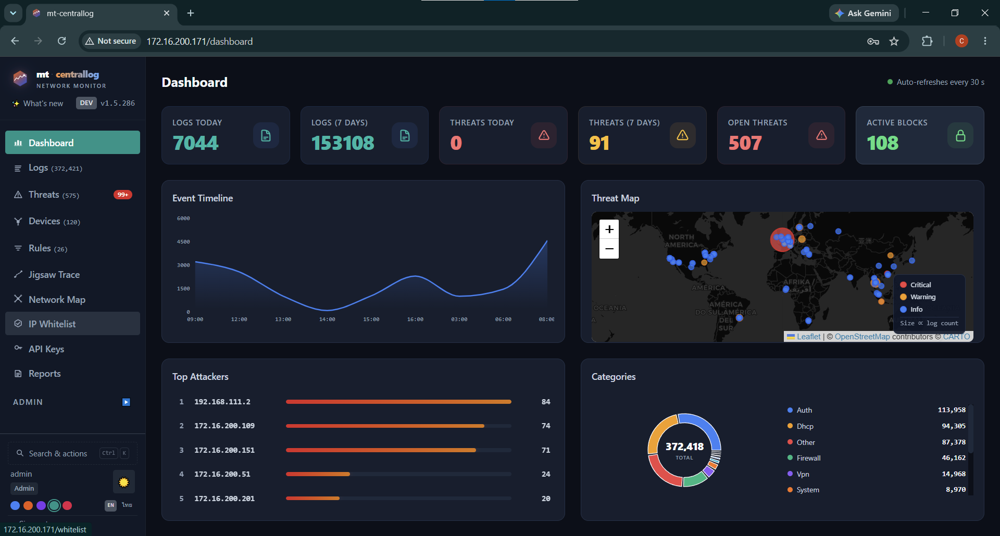
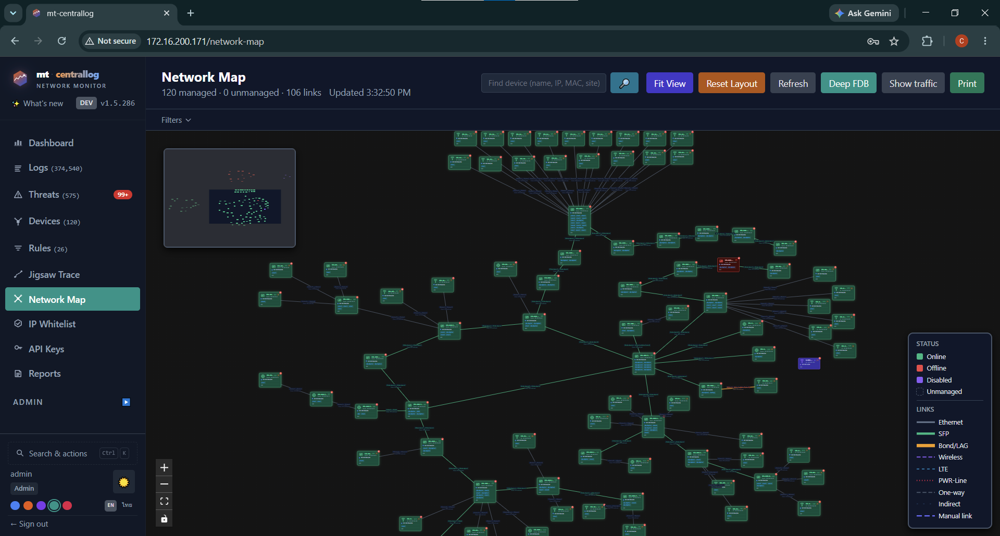
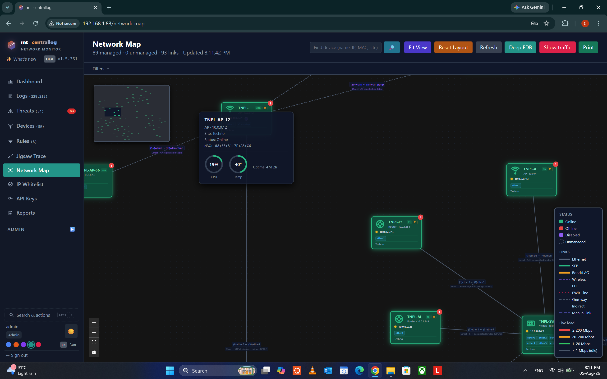
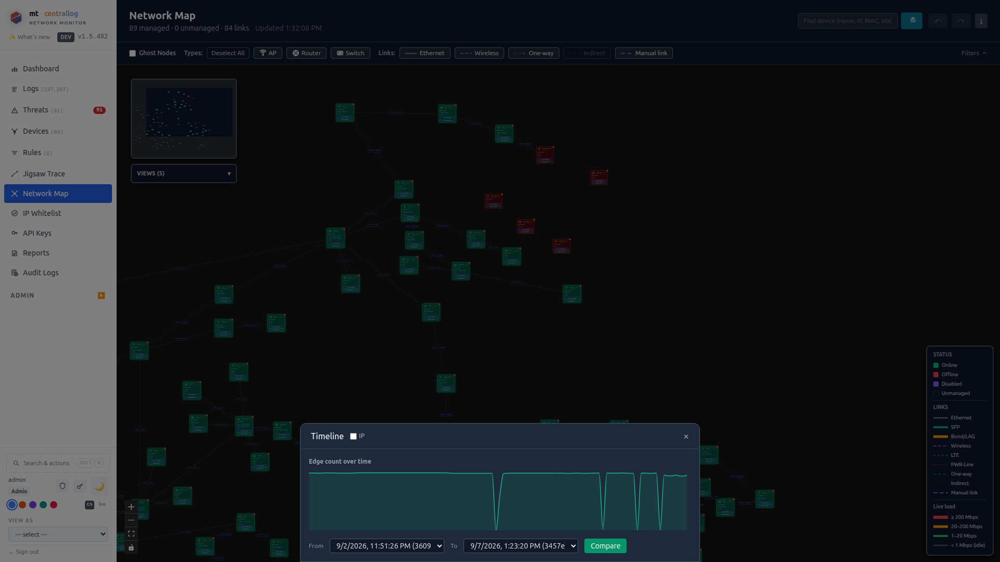
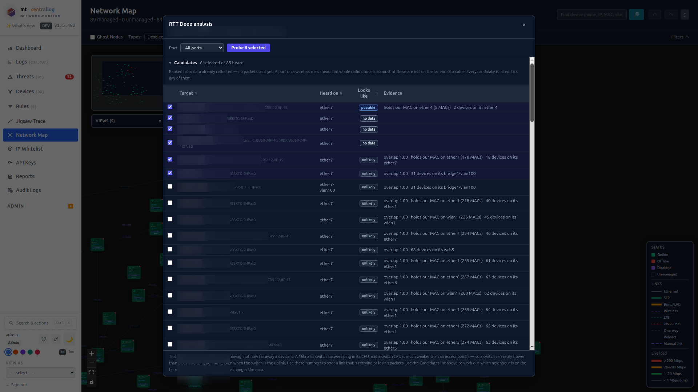
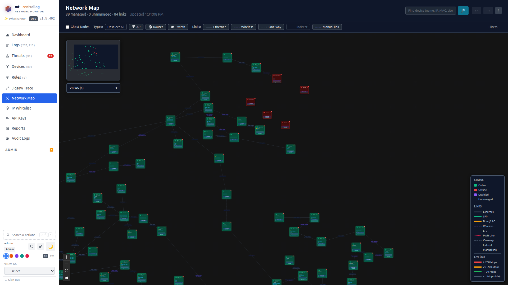
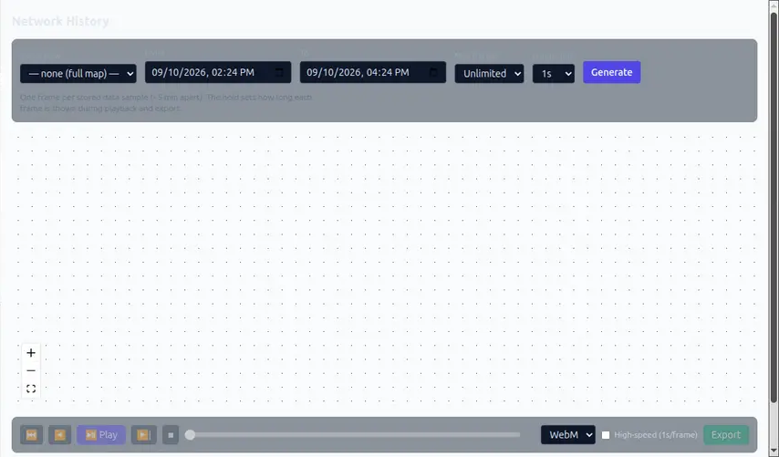
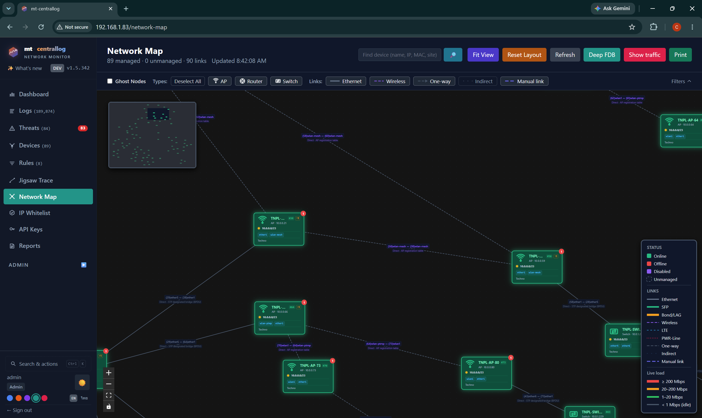
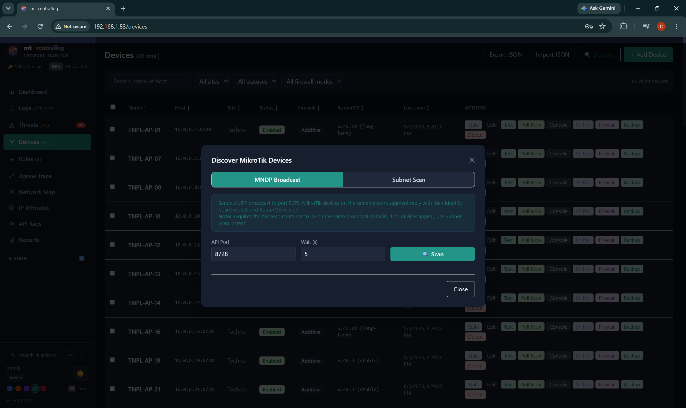
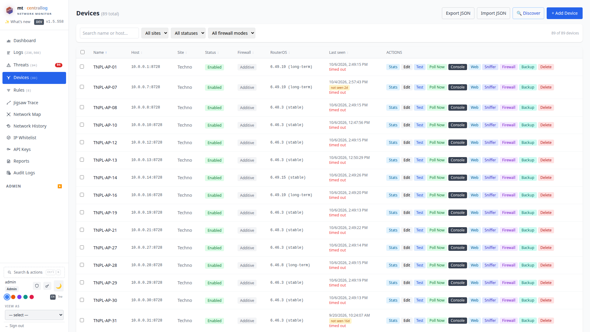
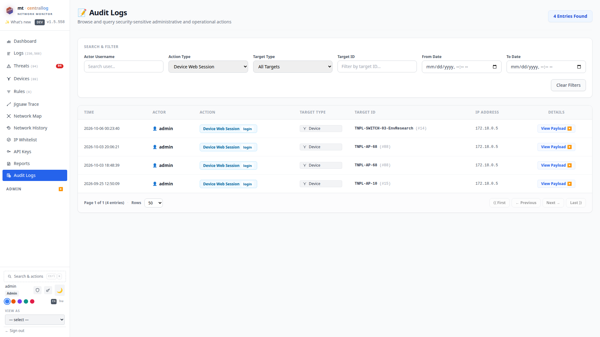
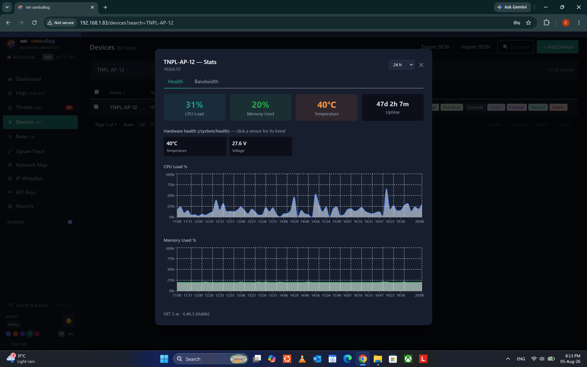
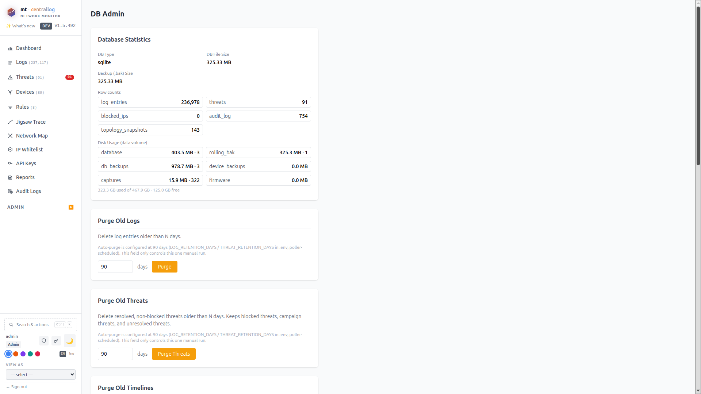
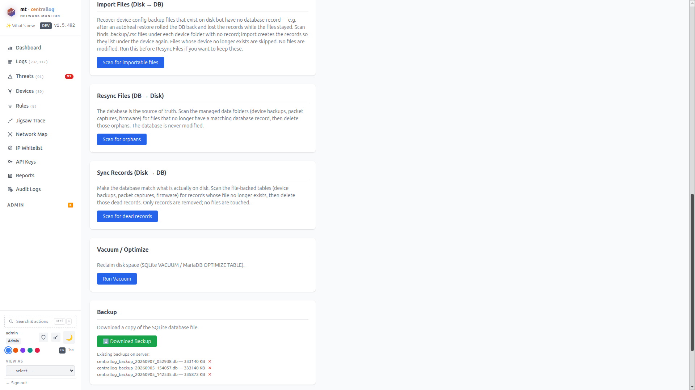
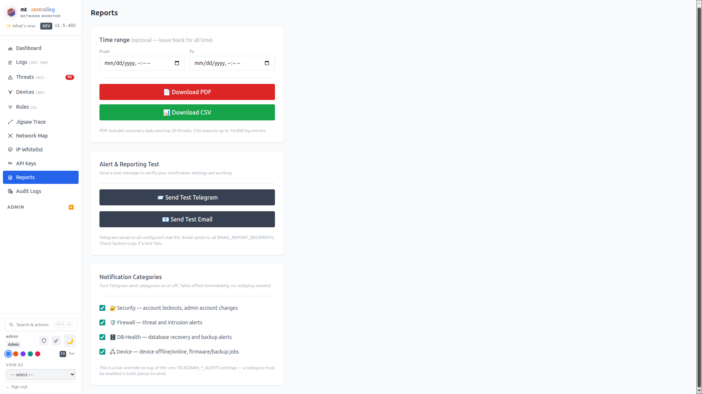
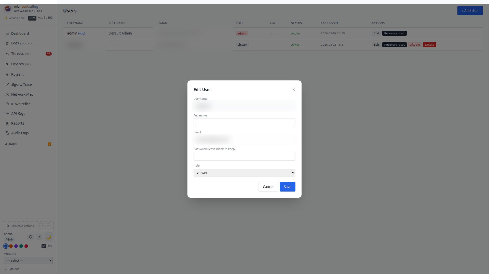
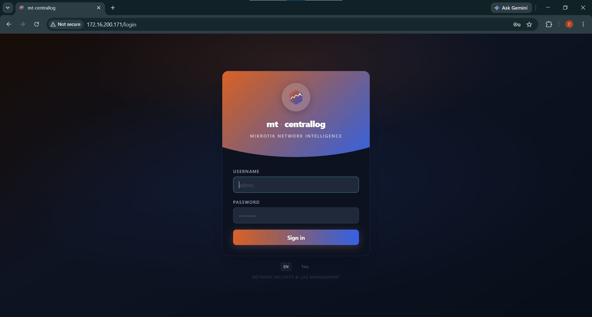

## Quick install

```bash
curl -fsSL https://raw.githubusercontent.com/cluangar/mt-centrallog-lite/main/install.sh | bash
```

That single command:
1. Checks Docker + Compose v2 are available.
2. Auto-detects your LAN interface / subnet / gateway.
3. Downloads the compose file + `.env.example` into `~/mt-centrallog-lite/`.
4. Generates a strong `SECRET_KEY` and internal `BACKEND_API_KEY`.
5. Runs `docker compose pull`.
6. **Measures this host's LAN address** and records it in `./host_facts`, so the certificate, the address a router fetches from you, and the neighbour listener all name the network you are actually on (facts only — the values step 2 detected are already in `.env`).
7. Starts the stack (`docker compose up -d`).
8. Schedules the host **DB watchdog** in your crontab (every 10 min) — see [Database protection](#database-protection).

When it finishes: browse to `http://<your-server-ip>/` — default login **admin / admin1234** (change it on first login).

## Requirements

- Linux host (amd64). Tested on Debian 12, Ubuntu 22.04 / 24.04.
- Docker Engine 24+ with Compose plugin (`docker compose version` must work).
- Free TCP ports 80 + 443 (override via `WEB_HTTP_PORT` / `WEB_HTTPS_PORT` in `.env`), plus 8071–8080 for the one-click device WebFig console (fixed, up to 10 concurrent windows) and 5679 for the MNDP relay's own read-only API (`GET /devices`, `GET /query`). The backend's own port 8000 is **not** published to the host — every API call goes through nginx on port 80.
- A LAN interface reachable by your MikroTik devices (needed for MNDP broadcast discovery). The ipvlan parent is `MNDP_PARENT_IFACE` (default `eth0`; set it to `wlan0`/`wlo1` on a Wi-Fi host).

## Update

```bash
cd ~/mt-centrallog-lite
./update.sh              # pull :latest and recreate
./update.sh 1.5.669      # pin to a specific version (writes IMAGE_TAG to .env)
./update.sh --refresh    # also re-download the compose file, host_facts.sh, update-mndp.sh, and the three watchdog scripts

Your `sqlite_data/`, `backup_data/`, `capture_data/`, and `.env` are never touched by an update — only images swap.

Any database schema change a release needs is applied automatically the first time the new backend image starts — there's no separate migration step to run.

## Change LAN settings

If auto-detect picked the wrong interface, or your LAN moved:

```bash
cd ~/mt-centrallog-lite
./update-mndp.sh         # interactive prompts for MNDP_* + BACKEND_FETCH_URL
docker compose down && docker compose up -d    # recreate the macvlan_lan network
```

⚠ **Since `1.5.666` the box follows its own address.** `host_facts.sh` reads this host's route and re-derives the settings that describe where it is — `MNDP_SUBNET`, `MNDP_GATEWAY`, `MNDP_IP_RANGE`, the certificate's `TLS_SAN` and `BACKEND_FETCH_URL` — rewriting only a value that disagrees, after copying `.env` to a temporary backup, and changing nothing at all when no LAN can be detected. `./update.sh` runs it with `--apply`, so does `./start.sh up|start|restart` — a move therefore needs no hand-edit: the leaf gains the new address from the **unchanged site CA** (devices that already trust the CA need nothing else) and the address routers fetch from is corrected before a device is ever sent to it. `install.sh` runs it facts-only, because that script already detects the neighbour-listener values itself. `TLS_SAN_AUTO=false` / `BACKEND_FETCH_URL_AUTO=false` restore the hand-typed behaviour, and `./update-mndp.sh` still works when you want to set those values yourself. **What no script can do is rebuild the virtual interface:** because the ipvlan is bound to your wireless card, `docker compose down && docker compose up -d` (or `./start.sh restart`) is what recreates `macvlan_lan` — a plain `restart` of the containers reuses the stale network, and a container address on a LAN the box no longer touches is invisible to every API and map check.

## Uninstall

```bash
cd ~/mt-centrallog-lite
./uninstall.sh              # stops stack, prompts before deleting data
./uninstall.sh --keep-data  # keeps sqlite_data/ backup_data/ capture_data/
```

## What's inside

Five containers pulled from GHCR:

| Image | Purpose |
|---|---|
| `ghcr.io/cluangar/mt-centrallog-lite-backend` | FastAPI + SQLAlchemy async, REST API, threat engine, auto block/unblock |
| `ghcr.io/cluangar/mt-centrallog-lite-poller` | librouteros polling loop, MNDP scanner, DHCP/DNS/lease scraper |
| `ghcr.io/cluangar/mt-centrallog-lite-frontend` | React SPA (Vite build) |
| `ghcr.io/cluangar/mt-centrallog-lite-nginx` | Reverse proxy + the SPA cache rules. On first boot it creates a **persistent site CA** (`ssl_certs/ca.crt`, valid `TLS_CA_DAYS`, published at `http://<your-ip>/ca.crt` for devices to enrol) and signs a leaf from it — `CA:FALSE`, `serverAuth`, `subjectAltName` taken from **`TLS_SAN`**, valid `TLS_LEAF_DAYS` (800 d, inside Apple's 825-day cap). Re-issuing that leaf never re-breaks a device that already trusts the CA; changing `TLS_SAN` needs `docker compose up -d --no-build --force-recreate --no-deps nginx` |
| `ghcr.io/cluangar/mt-centrallog-lite-mndp-relay` | UDP host-relay so containers see MNDP broadcasts |

Plus one sidecar not built by us: `tecnativa/docker-socket-proxy:0.3` (narrows the backend's Docker access to `/containers/*` + `/images/*` — needed for the Service Status page and post-restore auto-restart).

## Features

**Included in Lite:**

*Logging & threats*
- Multi-device MikroTik log collection over the RouterOS API
- Rule-based threat detection (detection-rule CRUD) + automatic block/unblock into a `centrallog-blocked` address list
- IP whitelist management, including dynamic-DNS tracking of a whitelisted hostname
- Risk scoring (0–100, severity + recidivism + subnet concentration) with automatic escalation, GeoIP threat map
- Per-threat trace (what the device actually did) and a full audit log of every operator action
- Logs / Threats / Rules / Whitelist / Trace / Audit pages, system-log viewer, service-status page, API keys for machine access

*Network map & discovery*
- MNDP network map: saved device positions, named views, undo/redo for moves, links, resets and views, Ctrl+K command palette — and a page that failed to load its saved layout never saves an empty one over it
- UDT **locate** — resolve an IP / MAC / hostname to the **switch and port** it is on, ranked best-first; hostname resolution runs through DHCP leases, static/cached DNS, and a live router probe
- Live per-link traffic load colouring, stale-link badging, and per-port chips on the device card that each state **what their link is** (uplink / backup / downstream / endpoint, coloured, evidence named on hover) with a **Show endpoint devices** switch to hide the access-port chips
- **Loop-storm watch**: a fleet-wide bridge loop detected from `bridge RX looped packet` log rows plus per-port rate spikes, announced once per episode, with an admin **Loop Storm** page that owns its settings and shows which ports are armed or tripped — plus opt-in use of the router's own loop protection and switch-chip storm limits, and the map colours the exact port each one is armed on
- Link-count timeline with A/B compare, and **Network History**: traffic replay over a time window with video export (WebM / MP4 / AVI)
- Per-device map tools: **Force update** (re-poll one device on demand and report the uplink it found) and **RTT deep probe** (ICMP path-quality classification to the neighbours heard on its ports)
- What-if view: `?mute=9,12` redraws the map as if those devices were gone, without touching them
- Device discovery by MNDP broadcast or by TCP subnet scan, with SNMP enrichment

*Wireless*
- PtMP / mesh / WDS links drawn from each AP's own registration table (no controller required)
- Per-band (2.4 / 5 / 6 GHz) + per-SSID client counts on the map and in the device's Wireless tab, with per-client signal (dBm) and tx/rx rate
- Weak / poor-signal surfacing per AP, overloaded-AP chip on the map, and per-AP client-count history charted over time
- Client manufacturer badges from the IEEE OUI registry (offline lookup)

*Devices*
- Binary `.backup` save + restore (exact, reboots the device)
- `.rsc` save + restore in **both** modes: fast `/import`, and **reset-first** restore with a rescue bootstrap so the device always comes back reachable on its current management IP — plus assisted recovery hints (locate-by-MAC via neighbours) when it does not
- Multi-IP / multi-VLAN device records, self-IP and managed-device protection so the app never blocks itself, firewall-rule resync between DB and device
- Full hardware-health panel (temperature / voltage / current / fans across CCR / CRS / RB), interface + uptime + CPU/memory history
- One-click **WebFig console** from a device row (the **Web** button, plus the open icon in the Console modal) — a ticket-gated auto-logged-in session, up to 10 concurrent windows on ports 8071–8080, with every open / login / close written to the audit log. Since `1.5.573` the opening page discards the router's stored console session in the browser before handing over the credentials, so the console opens logged in every time (it previously could land on the router's own login page when that stored session had gone stale)

*Alerting*
- Telegram: threat alerts, device offline/back-online, job completion, database health, and a periodic digest; quiet hours and alert-storm coalescing; optional inline Block / Whitelist / View buttons (off by default, acted on only from the chats alerts are sent to)
- Email: report delivery, forgot-password reset, 2FA recovery codes
- A per-category checklist on the Reports page (Security / Firewall / DB-Health / Device) to mute a category without editing `.env`

*Accounts & security*
- Roles `viewer < analyst < operator < admin`, per-endpoint enforcement, admin "view as" preview, TOTP 2FA with one-time recovery codes, self-service password change and email password reset, login rate limiting + lockout with security alerts
- `SECRET_KEY` startup gate, security headers, upload caps, SSH host-key learn-and-verify, docker-socket-proxy sidecar instead of a raw `docker.sock` mount
- English + Thai UI

*Database protection*
- Scheduled rolling backups every `DB_BACKUP_INTERVAL_HOURS` (default 4) plus the timestamped ones you take from DB Admin — written **without disturbing the running database** (SQLite online-backup API, read-only sources) and integrity-verified, so a corrupt page is never copied into a backup
- **Opt-in** startup auto-heal — `DB_AUTOHEAL_ENABLED=true` (the shipped template sets `false`; turn it on especially on SD / eMMC / USB storage) — which promotes the newest clean, non-empty backup when the database is unusable
- DB Admin page: backup/restore (restore is staged, applied safely at next start), purge, vacuum (which also runs `ANALYZE` to refresh SQLite's query-planner statistics), disk-usage breakdown, and a data-hygiene suite that reconciles DB rows with the files actually on disk (import orphan device backups, drop rows whose file is gone, delete files with no row)
- Host **DB watchdog** (`db_watchdog.sh`, cron every 10 min) — see below
- The watchdog checks the **application** as well as the database file: a backend container reading `unhealthy`, exited, or left in `created` by a recreate that never finished, and a database that is alive but stuck losing the write lock, are each recorded (`app_down`, `app_contention`) and warned. Two opt-in switches let it repair itself — `DB_WATCHDOG_APP_RESTART` and `DB_WATCHDOG_RAMDISK_RESTART` — each gated on consecutive flagged runs plus a cooldown, and both `false` in the shipped template.
- Both the watchdog and the poller keep a **durable record** that survives a container recreate: `.watchdog/events.tsv` (one row per flagged watchdog run) plus `.watchdog/heartbeat`, and `sqlite_data/events/poller.tsv` (one row per flagged poller failure) plus its own `heartbeat`. Read them with `./db_watchdog.sh events <run-dir> [N]`. ⚠ **No rows is not evidence the process stopped** — at the default `critical` level a healthy run writes nothing, so the heartbeat file's mtime is the liveness signal.
- Read-only **diagnostics** for an admin: `GET /api/v1/system/diagnostics` returns the app config, the real container mount table, disk usage, a size-and-tables verdict for every backup, live-database facts and a masked copy of `.env`; `GET /api/v1/system/diagnostics/bundle` returns the same as a `tar.gz` with the log tails added. Nothing in that path runs a backup, a `VACUUM` or a topology build, and every database read is read-only.

**Not in Lite (available in the Full edition):**
- AI pattern detection, adaptive rule proposals, predictive pre-blocking — the Lite UI hides those sections, and since `1.5.602` nothing in this edition asks the server for them (an earlier build polled the AI-rule status endpoint every minute and took a 404 each time; log noise only, no effect on any Lite feature).
- SNMP network-topology mapping (FDB / LLDP / Q-Bridge / CapsMan), SNMP device discovery and the SNMP settings page
- Continuous subnet host scanning (`scanned_hosts`) — Lite's locate resolves from DHCP/DNS and live router probes
- RouterOS firmware upgrade/downgrade jobs (including optional-package staging)
- Bulk CLI runner
- Wireless analysis page (fleet-wide load + weak-signal table)
- MariaDB backend option, MCP server, AR Port-Map API
- AbuseIPDB / Tor / proxy reputation **lookups** — Lite's risk scorer reads the reputation table (`risk_scorer.py:91`) and scores it if rows exist, but Lite ships no reputation service to fill it
- Ramdisk database mode

**Nothing is waiting on this edition.** `1.5.650` (the loop-storm watch, the Loop Storm settings page, port chips that state what their link is, bonded-port link speed, and the reviewed Thai labels) sits on top of `1.5.634` (uplink ports labelling themselves in the router, opt-in), `1.5.632` (MNDP discovery that accepts what it hears) and `1.5.631` (the pinned, patched nginx base), all still in force.

Lite and Full share the same DB schema and the same `.env` format — Lite → Full upgrade is a Docker image swap.

## Database protection (host watchdog)

`install.sh` and `update.sh` place three scripts next to your stack and add one crontab entry (`*/10`):

⚠ A plain `./update.sh` re-downloads those scripts **only when they are missing**. An install that already has them picks up a watchdog change by running `./update.sh --refresh` — the crontab entry is re-installed in the same step.

| Script | Role |
|---|---|
| `db_watchdog.sh` | the single command: `install` · `remove` · `status` · (no argument) run one check |
| `watchdog-cron.sh` | manages the crontab entry only |
| `recover_db.sh` | deep repair — auto-elevates with sudo when it needs it |

It checks the database two ways (a read-only `integrity_check` **and** the backend's own error log), keeps verified snapshots and per-incident forensics in `.watchdog/`, and — when `DB_WATCHDOG_AUTORECOVER=true` — stops both writers, heals the backend, then restarts the poller. Repeated failures trip a circuit breaker that stops auto-retrying until a human looks; clear it with `./db_watchdog.sh rearm`.

- It runs **as you**, not root, and never resurrects a stack you deliberately stopped.
- It is opt-in for unreliable storage (SD / eMMC / USB): `DB_WATCHDOG_ENABLED=false` by default, set it `true` on those disks.
- Telegram pings for watchdog events follow the **DB-Health** category on the Reports page plus `TELEGRAM_DB_ALERTS`.
- **It works in every storage mode now.** `DB_WATCHDOG_RAMDISK_MODE=skip|disk|live|both` (default `skip`): `disk` checks the copy in `sqlite_data`, `live` runs `PRAGMA quick_check` on the live in-RAM database **inside the backend container**, `both` does the two. Auto-recovery is always refused on a ramdisk install — a lagging disk copy is never promoted over a live RAM database.
- If the check itself fails with `attempt to write a readonly database`, set `DB_WATCHDOG_PROBE_VIA_CONTAINER=true`: the check and the snapshot then run inside the backend container, as the user that owns the database, and the result is copied out. ⚠ **Never fix that failure with `chown` or `chmod` on the data directory** — a sidecar your user creates is one the containers then cannot open.
- A snapshot is only accepted when it is at least `DB_WATCHDOG_SNAPSHOT_MIN_BYTES` **and** actually contains tables — an empty file passes `PRAGMA integrity_check` with `ok`, so integrity alone is not a test. Keep-count is `DB_WATCHDOG_SNAP_KEEP`, and each kept snapshot is the size of your database: on a multi-GB database 24 is not a safe default.
- A probe that keeps failing stops being a whisper: after `DB_WATCHDOG_PROBE_FAIL_ALERT` runs in a row it says so out loud and names the cause, at most once per `DB_WATCHDOG_PROBE_ALERT_REPEAT_SEC`.

Manual checks: `./db_watchdog.sh status` · `crontab -l | grep watchdog`. Remove it with `./watchdog-cron.sh remove` (or `./uninstall.sh`).

## Tunables worth knowing

Everything lives in `.env` and `docker compose up -d` re-reads it. A few are worth naming:

| Key | Value in `.env.example` | What it does |
|---|---|---|
| `LOG_RETENTION_DAYS` / `INTERFACE_STATS_RETENTION_DAYS` / `THREAT_RETENTION_DAYS` | see `.env` | how far back logs, per-interface traffic samples and threats are kept |
| `WIRELESS_WEAK_SIGNAL_DBM` / `WIRELESS_POOR_SIGNAL_DBM` | `-75` / `-85` | the weak / poor client thresholds |
| `WIRELESS_OVERLOAD_CLIENT_COUNT` | `30` | how many associated clients turn an AP's map chip amber |
| `WIRELESS_FRESHNESS_MINUTES` | `60` | how old a client sample may be before it is dropped from the counts — must outlive one full poll pass of your fleet |
| `WIRELESS_STATS_SAMPLE_INTERVAL_MINUTES` | `15` | cadence of the per-AP client-count history behind the device chart |
| `TOPOLOGY_POLL_INTERVAL_SECONDS` | `900` | how often the poller re-reads neighbours / FDB / spanning-tree — the evidence the map is built from |
| `WIRELESS_REG_EDGES` / `WIRELESS_FLOOD_DEMOTE` | `true` / `true` | turn the controller-less wireless links (and their flood demotion) off when a map link looks wrong |
| `TOPOLOGY_BRIDGE_VLAN_PORTS` | `true` | let the bridge VLAN membership table localise which port a link was heard on; `false` restores the name/parent-only resolution |
| `TOPOLOGY_STP_PORT_MOVE` | `true` | let a spanning-tree claim correct the **ports** of a link the map already holds (a root port names the exact port of the switch it is cabled to). `false` restores the old behaviour: such a claim may create a link, never relabel one. In the published build from `1.5.630` (it entered the source tree at `1.5.627`) |
| `PORT_PAIRING_LOOKBACK_HOURS` | `24` | how far back `GET /api/v1/devices/{id}/port-pairing` reads link-flap and byte-counter evidence (the endpoint's own `hours=` overrides it, max 168). In the published build from `1.5.630`; the endpoint itself arrived at `1.5.627` |
| `POLLER_ERROR_BACKOFF_MAX_SECONDS` | `900` | the ceiling of the per-device error back-off ladder — how long a device that keeps failing is left alone before it is tried again |
| `TOPOLOGY_SNAPSHOT_INTERVAL_S` / `TOPOLOGY_SNAPSHOT_RETENTION_DAYS` | `900` / `3` (code defaults `15` / `90`) | link-count timeline capture tick + retention |
| `MNDP_RELAY_DEBUG` / `MNDP_RELAY_HEARTBEAT_SEC` | `false` / `300` | the LAN relay: `true` logs every announcement it hears (one line per frame — useful only while debugging a network), and the heartbeat interval sets how often it prints its frames / port-hits / cached-devices summary. In the published build from `1.5.632` |
| `TLS_SAN_AUTO` / `BACKEND_FETCH_URL_AUTO` | `true` / `true` | let deploy/start re-derive this host's own address for the HTTPS certificate and for the address routers fetch from — `false` on either keeps exactly what you typed in `.env`. Both ship assigned in the published `.env.example` from `1.5.666` |
| `INTERFACE_COMMENT_AUTO_UPDATE` / `_INTERVAL_MINUTES` / `_PREFIX` / `_OVERWRITE` | `false` / `60` / `Uplink` / `false` | let the poller write `Uplink <peer>` comments on the ports its spanning-tree evidence identifies as uplinks — **off by default, so it never writes to a router until you opt in**; with `_OVERWRITE=false` a comment you typed is never replaced while a label the app wrote is still corrected |
| `LOOP_WATCH_ENABLED` / `LOOP_WATCH_INTERVAL_MINUTES` / `LOOP_WATCH_WINDOW_MINUTES` | `true` / `15` / `15` | the **read-only** storm watch: how often it re-reads the stored evidence and how far back each read goes — on by default, and it never touches a router. The look-back is **capped by** the check cycle, not floored by it: the defaults match (15 / 15, so every cycle is covered), a **shorter** look-back is honoured and the page states the stretch it leaves unchecked, and a wider one is read back down to the cycle. The measured reason both numbers matter: a 10-minute window under a 15-minute cycle left 425 looped-packet rows across 73 devices outside every assessment window during the 2026-11-19 storm |
| `LOOP_MIN_ROWS` / `LOOP_MIN_DEVICES` / `FLOOD_MIN_SPIKES` / `FLOOD_MIN_DEVICES` / `FLOOD_SPIKE_MBPS` / `FLOOD_SPIKE_FACTOR` / `LOOP_WATCH_REALERT_MINUTES` | `50` / `5` / `20` / `5` / `100` / `5` / `60` | what counts as a storm, and how often a continuing one is re-announced. The defaults sit in the measured gap between a quiet day (5 rows / 1 device, 7 spikes) and a real storm (453–961 rows across 61–84 devices) |
| `LOOP_GUARD_ENABLED` / `LOOP_GUARD_STORM_RATE_PCT` | `false` / `5` | device write: throttle broadcast/unknown-unicast/unknown-multicast flooding in the switch chip at this **cap** on each port's own link speed (1–100, `100` = unlimited; drawn as a slider beside its switch on **Admin ▸ Loop Storm**) — the share those frame classes may use while a storm is declared, not a load the port must reach. Only boards whose chip carries those words are written, and the poller says when a device has no such control |
| `LOOP_PROTECT_ENABLED` / `LOOP_PROTECT_MIN_PEERS` / `LOOP_PROTECT_MAX_PORTS` / `LOOP_PROTECT_DISABLE_TIME` | `false` / `3` / `8` / `5m` | device write: arm the router's own loop protection on multi-linked risk devices only, at most 8 ports per device per cycle, keeping a tripped port disabled for `5m` (a `0` or malformed value falls back to `5m`, because `0s` would leave the port down) |
| `TELEGRAM_LOOP_ALERTS` | `true` | storm notices, once per episode — also a checkbox on **Reports ▸ Notification Categories** |
| `TELEGRAM_*` | see `.env` | which alert types are sent, digest interval, quiet hours, inline buttons |
| `DB_WATCHDOG_ENABLED` / `DB_WATCHDOG_AUTORECOVER` / `DB_WATCHDOG_RAMDISK_MODE` | `false` / `true` / `skip` | the host watchdog: opt-in on unreliable disk, and what it does on a ramdisk install (see above) |
| `DB_WATCHDOG_PROBE_VIA_CONTAINER` / `DB_WATCHDOG_PROBE_FAIL_ALERT` / `DB_WATCHDOG_PROBE_ALERT_REPEAT_SEC` | `false` / `3` / `86400` | run the check and the snapshot inside the backend container when a root-owned data directory makes the host's read-only open fail, and how often a repeated failure is announced |
| `DB_WATCHDOG_SNAP_KEEP` / `DB_WATCHDOG_SNAPSHOT_MIN_BYTES` | `24` / `10000000` | how many snapshots are kept — each is as large as the database — and the floor below which one is thrown away and recorded as rejected |
| `DB_WATCHDOG_ERR_THRESHOLD` / `DB_WATCHDOG_ERR_WINDOW_MIN` | `3` / `12` | the second detection signal: backend `malformed` log lines counted over a plain wall-clock window |
| `EVENTS_ENABLED` / `EVENTS_DIR` / `EVENTS_LEVEL` / `EVENTS_LINES` | `true` / `/data/events` / `critical` / `2000` | the poller's critical-event record (`poller.tsv` + `heartbeat`) |
| `DIAGNOSTICS_INTEGRITY_MAX_MB` / `DIAGNOSTICS_BUNDLE_MAX_MB` / `DIAGNOSTICS_LOG_TAIL` | `500` / `25` / `500` | caps on the read-only diagnostics endpoints: integrity scanning, bundle size, per-container log tail |
| `DB_AUTOHEAL_ENABLED` | `false` in the template (the code default is `true`) | startup auto-heal |

⚠ **Since `1.5.650` the `LOOP_*` / `FLOOD_*` keys are only starting values.** The first time anyone saves **Admin ▸ Loop Storm**, the settings move into the database and that row wins: the poller re-reads it at the start of its next watch cycle (15 min), so a change on the page lands with no recreate, and editing those keys in `.env` afterwards does nothing until the row is deleted.

⚠ Changing an app value needs `docker compose up -d` (a **recreate**), not `docker compose restart` — a restart does not re-read `.env`. The one exception is the `DB_WATCHDOG_*` keys: `db_watchdog.sh` reads them from `<run-dir>/.env` on every cron run, so a saved value takes effect on the next run with no recreate — and `export DB_WATCHDOG_…` before a manual run does nothing, because the file wins.

## License

TBD. Do not redistribute without permission until this section is filled in.

## Support

Issues + questions: [github.com/cluangar/mt-centrallog-lite/issues](https://github.com/cluangar/mt-centrallog-lite/issues)
