# mt-centrallog Lite

Self-hosted MikroTik central logging with rule-based threat detection, auto block/unblock, an MNDP network map with switch-port locate and MAC→IP/VLAN host lookup, one-click device WebFig console, device backup/restore (binary and reset-first `.rsc`), per-AP wireless client monitoring, and Telegram + email alerting. Docker Compose, SQLite, single-node.

**Current release: `1.5.615`** — pushed 2026-11-13 · pin with `./update.sh 1.5.615` · **no schema change**

GHCR `:latest` == `1.5.615`: `backend ada7600a…` · `poller 3f26c78b…` · `frontend 2eef1ee0…` · `nginx d8a244a1…` · `mndp-relay 24c0d278…`. `poller`, `nginx` and `mndp-relay` are **the same images as `1.5.612`** — nothing in this range touches them, and each one's baked file was md5-compared to the source before publishing (`/etc/nginx/conf.d/default.conf` `45ff8445…`, `/entrypoint.sh` `dfaf857b…`, `/app/app.py` `453a1a43…`, `mikrotik_client.py` `0d51dfa9…`, `arp_parse.py` `b370bd84…`, `poller.py` `e779d2d8…`, `poll_backoff.py` `9862c170…`, `events.py` `7902581e…`).

- **Network History now replays the past as it was, not as today.** Every device card used to be coloured from the **live** map status, so a switch that is unreachable right now showed as down on every date you replayed. Each frame now carries its own device state — **online** (a fresh health sample at or before that frame), **offline** (a stale one), and **neutral / dimmed when the frame has no evidence at all** — and a device that is simply Disabled is never claimed down. A real outage longer than the replay's lookback still plays **down → recovered**, because the builder now anchors each enabled device with its newest sample from before the window.
- **The History page no longer goes blank after pressing Generate.** A frame-state helper was used without being imported, so the page threw a `ReferenceError` the moment frames arrived and the whole view disappeared with no message — now fixed, and a new source check fails the build when any page calls a helper from `src/utils/` without importing it.
- **The version in the header is right on a fresh install.** The app's built-in minor-version default disagreed with what every shipped `.env` states, so a box whose `.env` omitted `APP_VERSION_MINOR` reported `v1.4.x` in the UI while running a `1.5.x` release.

⚠ **Images only** — no `db_watchdog.sh` / `recover_db.sh` / `watchdog-cron.sh` change in this range, no migration, and no new `.env` key, so a plain `./update.sh 1.5.615` is enough; no `--refresh` needed.

**Previous releases, in short:**

| Version | What it fixed |
|---|---|
| `1.5.612` | **Evidence from a switch you deleted no longer describes your network.** An SNMP target's harvested rows — bridge-table (FDB), ARP, LLDP, LAG members — key on the switch's MAC with **no foreign key**, so deleting the target left every row it had been polled into behind: never re-polled, never aged out (a row only expires when a poll observes it missing, and a deleted target is never polled), and still steering the map and the MAC→IP host answers. Now an SNMP claim needs an **owner** — the reporting device must still exist and be enabled — every refusal is counted and named (`topology.snmp_claim_unowned_evidence`), and `/topology/locate` reports how many port candidates were refused for want of an owner. New key `SNMP_CLAIM_OWNER_GATE=true` (ships on; set `false` to restore the old behaviour). |

| `1.5.611` | A MAC search now names the VLAN each address lives on: every IP a MAC holds, with its VLAN, subnet, the device that reported it, which source produced it and how old the evidence is (freshest first, past `HOST_LOOKUP_FRESH_MINUTES` = 30 badged stale rather than hidden), via `GET /api/v1/topology/mac-hosts` and inside `GET /api/v1/topology/locate`. The VLAN tables that made that possible — `device_vlan_ifaces` / `bridge_vlan_ports` — had **never held a row on any box**: RouterOS answers `vlan-id` / `vlan-ids` as numbers and the harvest read them with a string method, so every read raised, the bare `except` called that "menu missing", and the caller returned an empty list **before its delete**; parsing is now a pure unit-tested helper that accepts ints, comma lists and small ranges, refuses a wide `1-4094`, drops disabled interfaces and counts every refusal (0 → 6,983 rows where bridge VLAN filtering is used). An IP search stopped answering every address a stale row touched (146 days of one row returned 21 hosts; after the fix, 1 host, port cards unchanged). And a device the poller cannot reach is no longer reported as a map fault: `/topology/health` splits "the map cannot place it" from "no poll reached it", muting a device the current poll window missed **and** whose own row carries a named poll failure. ⚠ Carried `1.5.608`–`1.5.610`, never published separately. |
| `1.5.607` | The watchdog stopped calling a healthy database corrupt: its verdict now comes from a read **inside the backend container**, because in WAL mode a copy of the main file alone misses the recent commits and can look broken while the live database is fine (a disagreeing copy is reported, never acted on). A lost write lock is contention, not damage — `database is locked` is a benign probe shape, and the backend's own locked writes are counted (`DB_WATCHDOG_LOCK_ALERT`, default 5) as `app_contention` **with no restart**, since stopping the writers cannot release a lock another process holds. It also watches the **application**: a backend left `unhealthy` / exited / `created` by a recreate that never finished is recorded as `app_down`, and `DB_WATCHDOG_APP_RESTART` (off by default, streak + cooldown gated) can bring backend + poller back. Plus: `mikrotik.stp_entries_without_role` now fires only when a root/alternate/backup role really disappears (was 36× a day describing nothing), and Discover → Subnet Scan result rows render at the window's own size. ⚠ Needed `./update.sh --refresh` for the watchdog scripts. |
| `1.5.602` | The per-device retry delay was capped at the same number its base already was (300 s), so it never backed off — now 300 → 600 → 1,200 s up to `POLLER_ERROR_BACKOFF_MAX_SECONDS` (900), and still interruptible so **Poll Now** and the RTT probe reach a backing-off device. `/topology/health` separates a device the map cannot place from one no poll has touched in a day. The UI stopped polling endpoints this edition does not have (278 × "not found" → 0). |
| `1.5.599` | Device passwords stopped landing in the logs (keep `LOG_LEVEL=INFO`). A map link built from bridge-table evidence now needs every port sighting to agree. The proxy keeps a **persistent site CA** and signs a leaf named by `TLS_SAN`, so a certificate refresh no longer re-breaks every enrolled phone. ⚠ Needed `./update.sh --refresh` + `TLS_SAN=IP:<your-ip>,DNS:localhost` + recreate nginx. |
| `1.5.593` | A read that died part-way used to leave the rest of its reply on the wire, so the **next** command got the previous command's rows — the connection is now ended and reopened cleanly. An all-zero MAC is refused as a client identity. Log calls take named values (the logger does not substitute `%s`, so those lines were invisible to every filter). The diagnostics bundle scrubs credentials from log tails. |
| `1.5.583` | The watchdog keeps its own durable record plus a `heartbeat`; snapshots are rejected when 0-byte or schema-less; `recover_db.sh` gates candidates by size, schema and a `users` row; `DB_WATCHDOG_PROBE_VIA_CONTAINER=true` checks from inside the backend container; admin diagnostics are capped by `DIAGNOSTICS_INTEGRITY_MAX_MB`. |
| `1.5.575` | A router reporting one address twice (its VRRP address and the VLAN interface) used to throw away the device's whole ARP refresh. Routers with no wireless menu stopped flooding the log. |
| `1.5.573` | The WebFig console opens logged in every time (RouterOS 7 resumes with a stored browser session before using the credentials). Failed console requests name their error. The page is served `no-cache` and version-stamped assets `immutable`, so `Ctrl+Shift+R` is no longer needed after `./update.sh`. |
| `1.5.570` | A map page that failed to load its saved layout no longer saves an empty one over it, and the server refuses a save that would erase stored manual links or named views. |
| `1.5.569` | Console cookies are per session, not per port — a re-used port cannot hand an old router's session to a new device. Database Admin **Vacuum** also runs `ANALYZE`. |
| `1.5.567` | Capture deletion updates the list and reports failure; the `capture_start` audit row carries the real id; the console stops copying the router's own `Date`/`Server` headers. |
| `1.5.564` | Opening a router's web console is audited as `open` → `login` → `close`. |
| `1.5.563` | Network History replay ships only the links it can draw (a 2-hour window 20 MB → 6.7 MB plain / 0.6 MB compressed); nginx no longer spills layout saves to a disk temp file. |
| `1.5.561` | Network Map load-failure diagnostics + `gzip_proxied any`. |

> **Older releases stay available.** Git tags run `v1.5.558` … `v1.5.615`; the image registry is deeper — `1.5.286` through `1.5.615` plus `latest`, **48 tags on each of the five images** (47 version tags + `latest`; read from GHCR 2026-11-13, not contiguous: releases were published on the versions that shipped, `1.5.608`–`1.5.610` were folded into `1.5.611`, and `1.5.613`–`1.5.614` into `1.5.615`). So `./update.sh 1.5.570`, or any version back to `1.5.286`, pins an older release.

> **Repo status:** this repository ships the **installer + pre-built Docker images only**. The source lives in the private full repo. Everything here is what `install.sh` needs and what `docker compose pull` fetches.

## Videos

https://www.youtube.com/watch?v=5XYOWSiuobE

## Screenshots

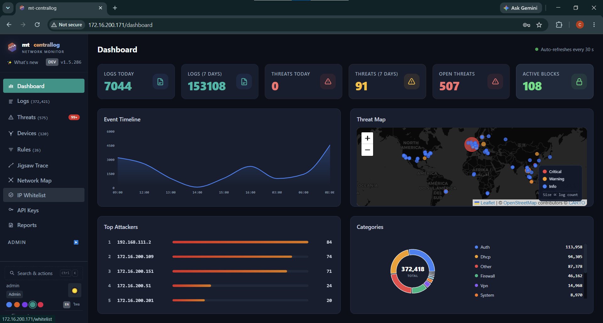
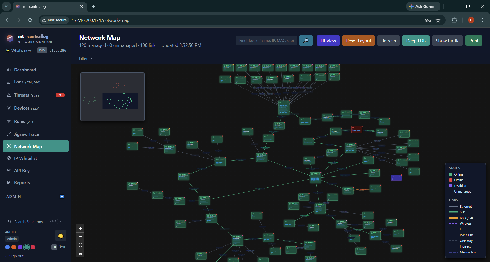
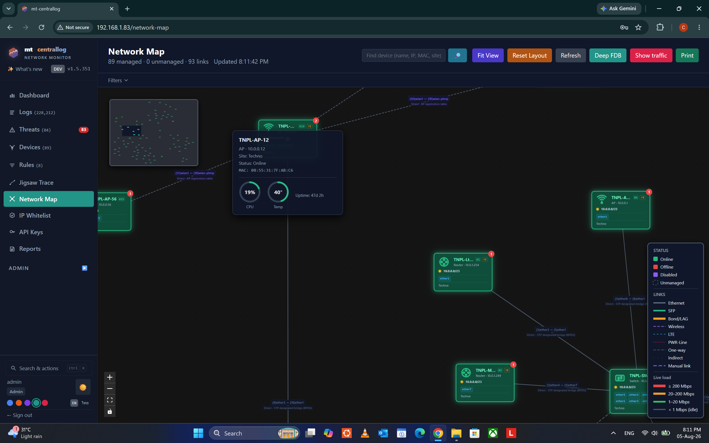
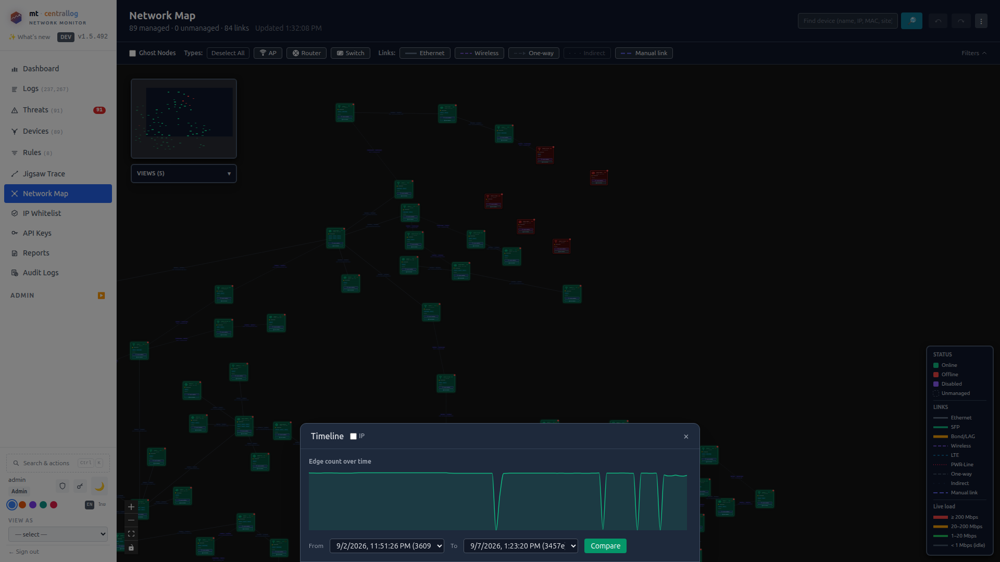
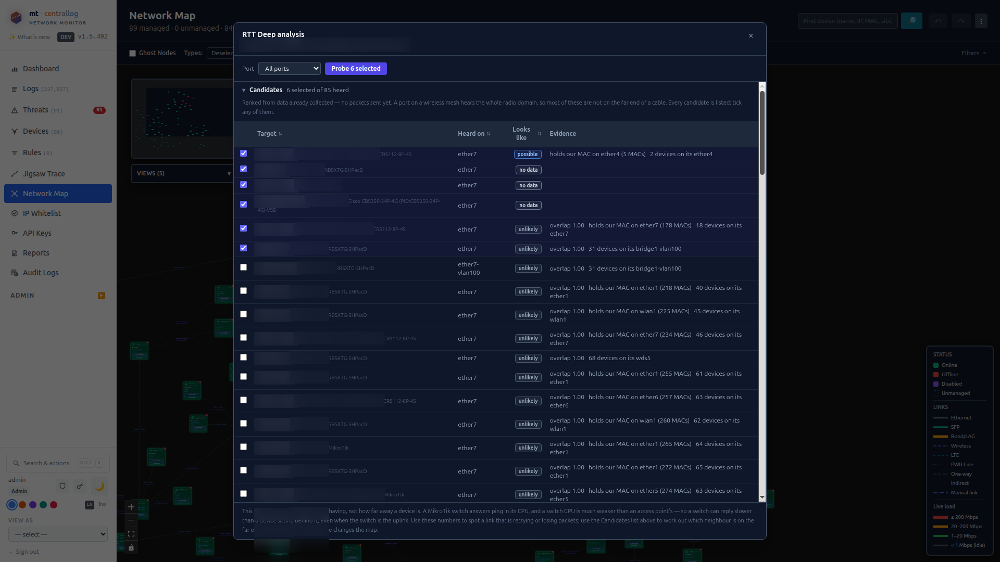
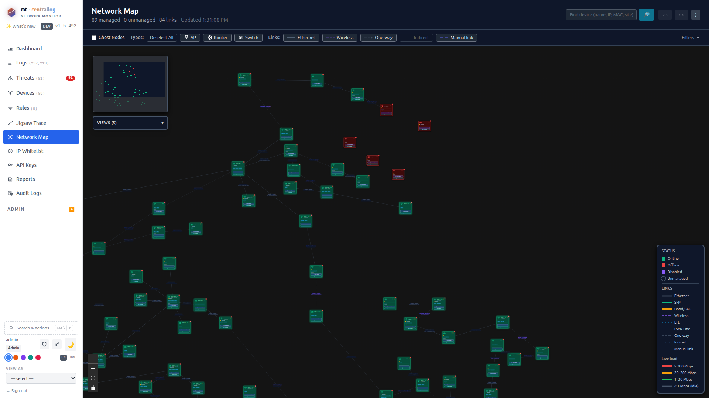
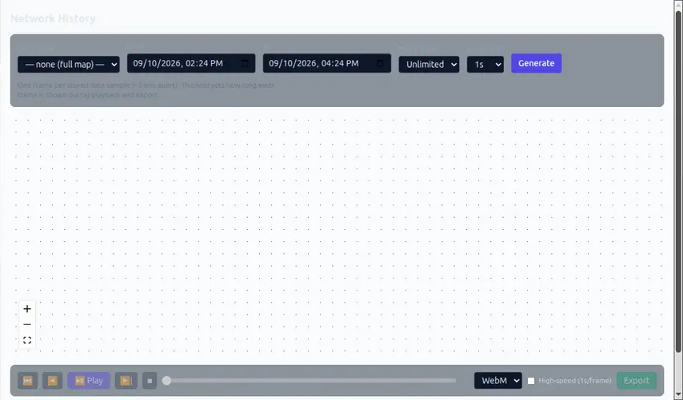
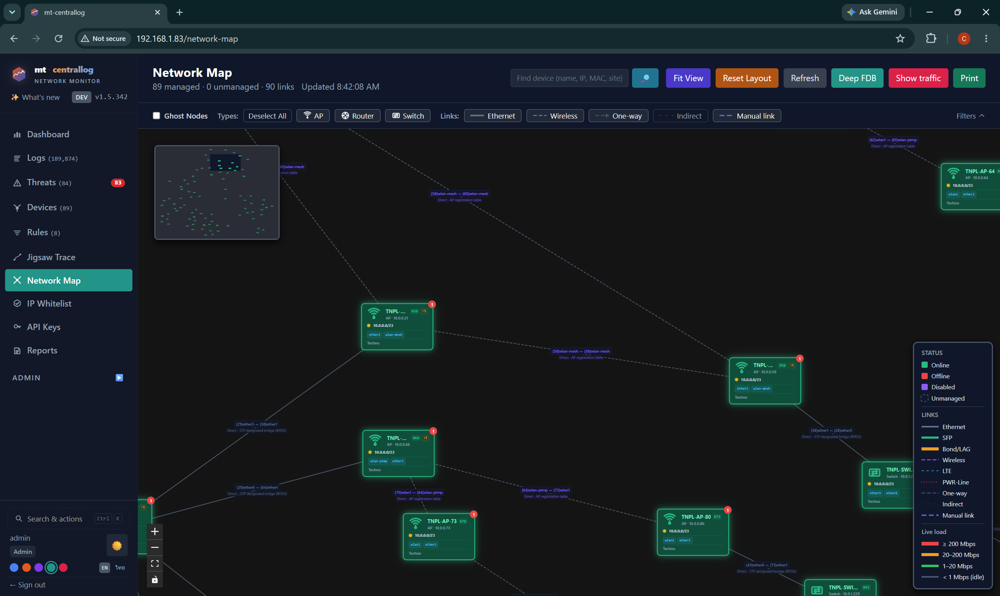
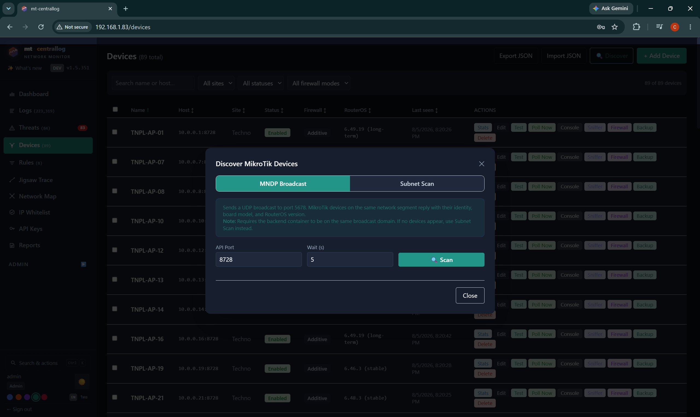
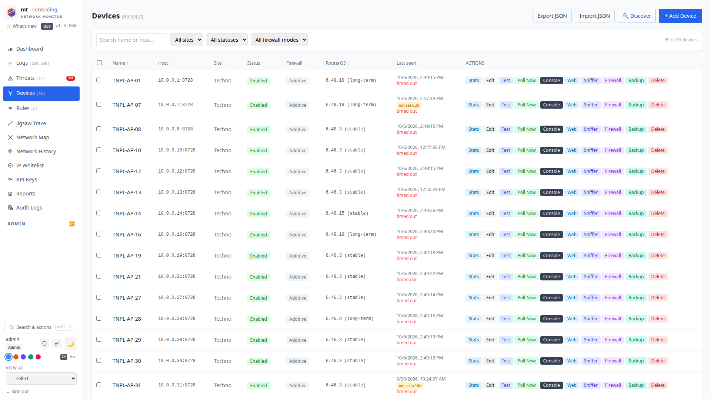
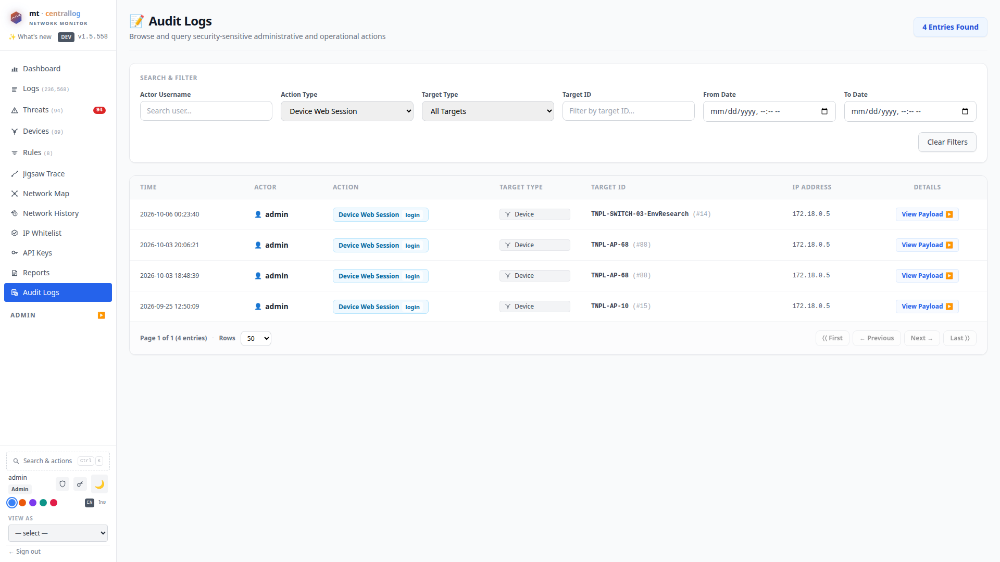
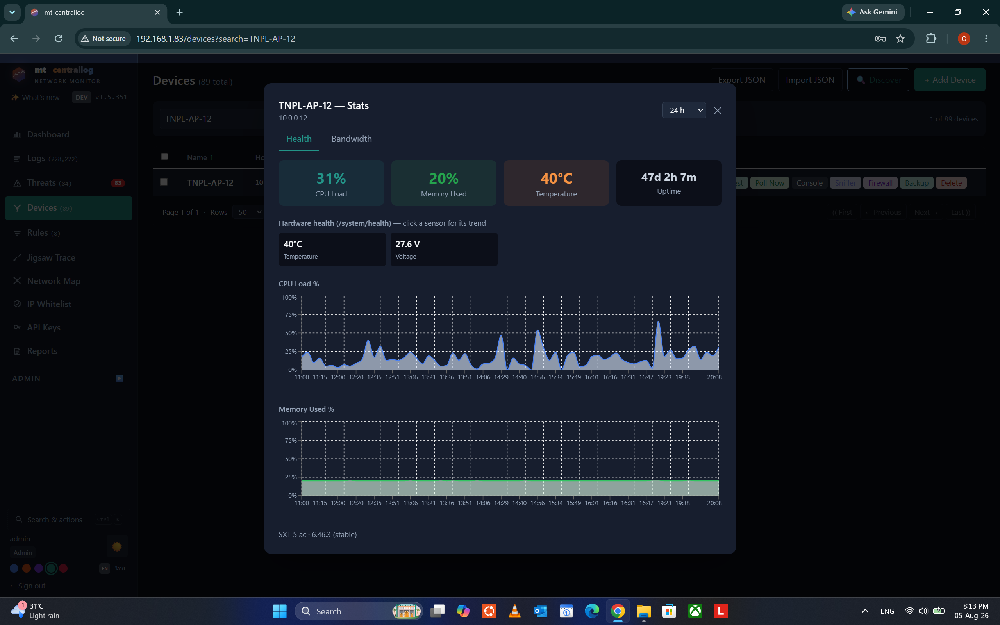
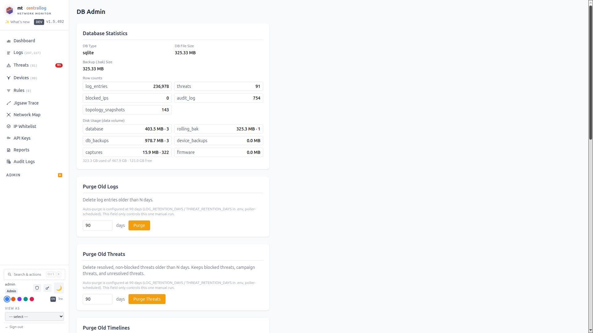
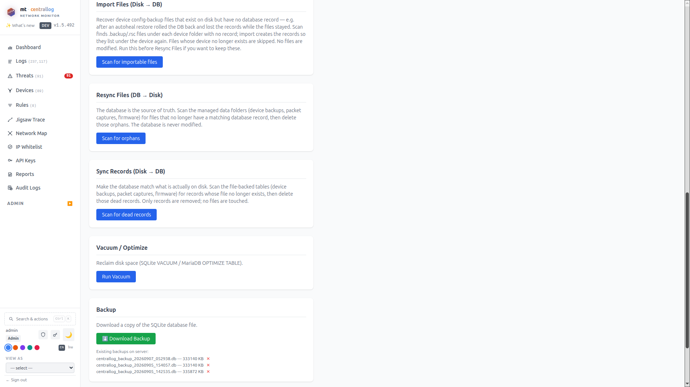
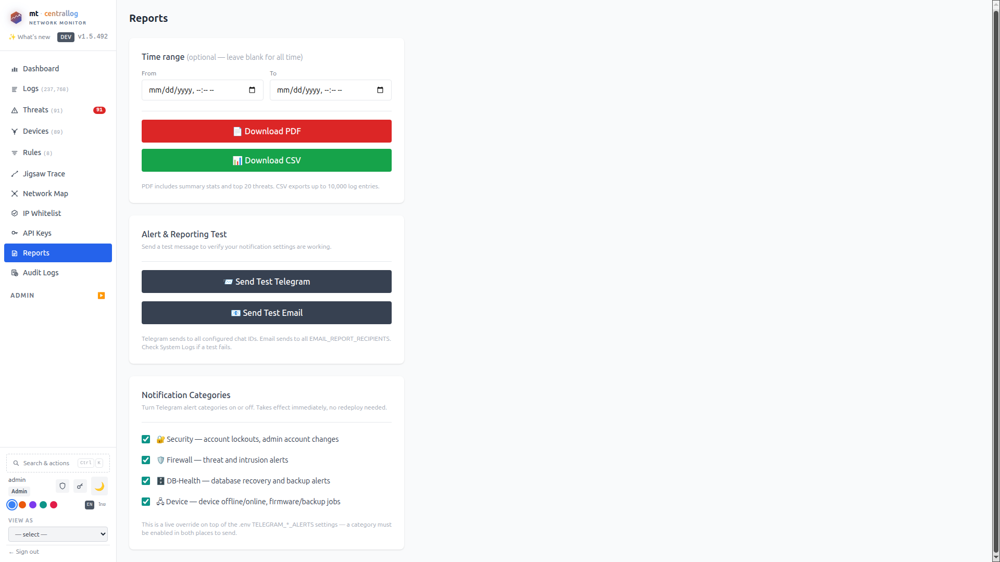
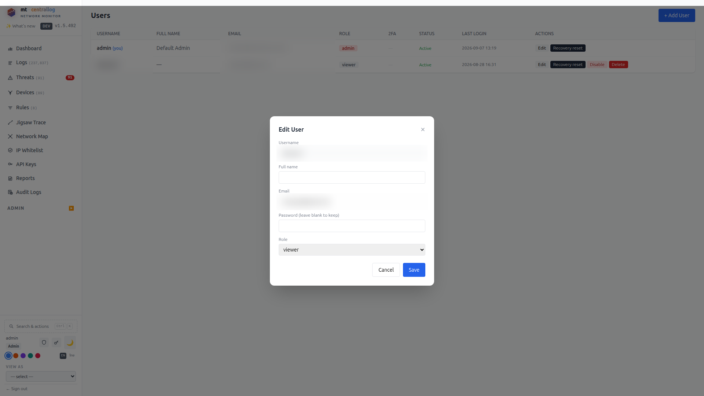
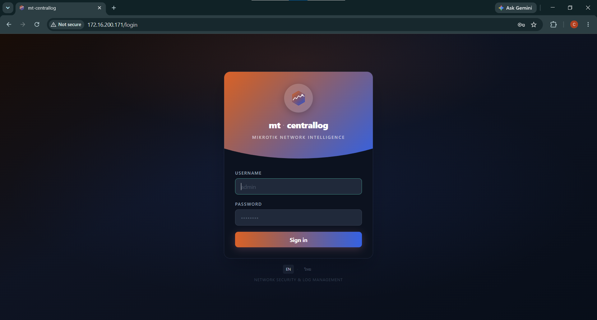

## Quick install

```bash
curl -fsSL https://raw.githubusercontent.com/cluangar/mt-centrallog-lite/main/install.sh | bash
```

That single command:
1. Checks Docker + Compose v2 are available.
2. Auto-detects your LAN interface / subnet / gateway.
3. Downloads the compose file + `.env.example` into `~/mt-centrallog-lite/`.
4. Generates a strong `SECRET_KEY` and internal `BACKEND_API_KEY`.
5. Runs `docker compose pull && docker compose up -d`.
6. Schedules the host **DB watchdog** in your crontab (every 10 min) — see [Database protection](#database-protection).

When it finishes: browse to `http://<your-server-ip>/` — default login **admin / admin1234** (change it on first login).

## Requirements

- Linux host (amd64). Tested on Debian 12, Ubuntu 22.04 / 24.04.
- Docker Engine 24+ with Compose plugin (`docker compose version` must work).
- Free TCP ports 80 + 443 (override via `WEB_HTTP_PORT` / `WEB_HTTPS_PORT` in `.env`), plus 8071–8080 for the one-click device WebFig console (fixed, up to 10 concurrent windows) and 5679 for the MNDP relay's own read-only API (`GET /devices`, `GET /query`). The backend's own port 8000 is **not** published to the host — every API call goes through nginx on port 80.
- A LAN interface reachable by your MikroTik devices (needed for MNDP broadcast discovery). The ipvlan parent is `MNDP_PARENT_IFACE` (default `eth0`; set it to `wlan0`/`wlo1` on a Wi-Fi host).

## Update

```bash
cd ~/mt-centrallog-lite
./update.sh              # pull :latest and recreate
./update.sh 1.5.602      # pin to a specific version (writes IMAGE_TAG to .env)
./update.sh --refresh    # also re-download the compose file, update-mndp.sh, and the three watchdog scripts
```

Your `sqlite_data/`, `backup_data/`, `capture_data/`, and `.env` are never touched by an update — only images swap.

Any database schema change a release needs is applied automatically the first time the new backend image starts — there's no separate migration step to run.

## Change LAN settings

If auto-detect picked the wrong interface, or your LAN moved:

```bash
cd ~/mt-centrallog-lite
./update-mndp.sh         # interactive prompts for MNDP_* + BACKEND_FETCH_URL
docker compose down && docker compose up -d    # recreate the macvlan_lan network
```

## Uninstall

```bash
cd ~/mt-centrallog-lite
./uninstall.sh              # stops stack, prompts before deleting data
./uninstall.sh --keep-data  # keeps sqlite_data/ backup_data/ capture_data/
```

## What's inside

Five containers pulled from GHCR:

| Image | Purpose |
|---|---|
| `ghcr.io/cluangar/mt-centrallog-lite-backend` | FastAPI + SQLAlchemy async, REST API, threat engine, auto block/unblock |
| `ghcr.io/cluangar/mt-centrallog-lite-poller` | librouteros polling loop, MNDP scanner, DHCP/DNS/lease scraper |
| `ghcr.io/cluangar/mt-centrallog-lite-frontend` | React SPA (Vite build) |
| `ghcr.io/cluangar/mt-centrallog-lite-nginx` | Reverse proxy, self-signed cert on first boot |
| `ghcr.io/cluangar/mt-centrallog-lite-mndp-relay` | UDP host-relay so containers see MNDP broadcasts |

Plus one sidecar not built by us: `tecnativa/docker-socket-proxy:0.3` (narrows the backend's Docker access to `/containers/*` + `/images/*` — needed for the Service Status page and post-restore auto-restart).

## Features

**Included in Lite:**

*Logging & threats*
- Multi-device MikroTik log collection over the RouterOS API
- Rule-based threat detection (detection-rule CRUD) + automatic block/unblock into a `centrallog-blocked` address list
- IP whitelist management, including dynamic-DNS tracking of a whitelisted hostname
- Risk scoring (0–100, severity + recidivism + subnet concentration) with automatic escalation, GeoIP threat map
- Per-threat trace (what the device actually did) and a full audit log of every operator action
- Logs / Threats / Rules / Whitelist / Trace / Audit pages, system-log viewer, service-status page, API keys for machine access

*Network map & discovery*
- MNDP network map: saved device positions, named views, undo/redo for moves, links, resets and views, Ctrl+K command palette — and a page that failed to load its saved layout never saves an empty one over it
- UDT **locate** — resolve an IP / MAC / hostname to the **switch and port** it is on, ranked best-first; hostname resolution runs through DHCP leases, static/cached DNS, and a live router probe
- Live per-link traffic load colouring, stale-link badging, per-port chips on the device card
- Link-count timeline with A/B compare, and **Network History**: traffic replay over a time window with video export (WebM / MP4 / AVI)
- Per-device map tools: **Force update** (re-poll one device on demand and report the uplink it found) and **RTT deep probe** (ICMP path-quality classification to the neighbours heard on its ports)
- What-if view: `?mute=9,12` redraws the map as if those devices were gone, without touching them
- Device discovery by MNDP broadcast or by TCP subnet scan, with SNMP enrichment

*Wireless*
- PtMP / mesh / WDS links drawn from each AP's own registration table (no controller required)
- Per-band (2.4 / 5 / 6 GHz) + per-SSID client counts on the map and in the device's Wireless tab, with per-client signal (dBm) and tx/rx rate
- Weak / poor-signal surfacing per AP, overloaded-AP chip on the map, and per-AP client-count history charted over time
- Client manufacturer badges from the IEEE OUI registry (offline lookup)

*Devices*
- Binary `.backup` save + restore (exact, reboots the device)
- `.rsc` save + restore in **both** modes: fast `/import`, and **reset-first** restore with a rescue bootstrap so the device always comes back reachable on its current management IP — plus assisted recovery hints (locate-by-MAC via neighbours) when it does not
- Multi-IP / multi-VLAN device records, self-IP and managed-device protection so the app never blocks itself, firewall-rule resync between DB and device
- Full hardware-health panel (temperature / voltage / current / fans across CCR / CRS / RB), interface + uptime + CPU/memory history
- One-click **WebFig console** from a device row (the **Web** button, plus the open icon in the Console modal) — a ticket-gated auto-logged-in session, up to 10 concurrent windows on ports 8071–8080, with every open / login / close written to the audit log. Since `1.5.573` the opening page discards the router's stored console session in the browser before handing over the credentials, so the console opens logged in every time (it previously could land on the router's own login page when that stored session had gone stale)

*Alerting*
- Telegram: threat alerts, device offline/back-online, job completion, database health, and a periodic digest; quiet hours and alert-storm coalescing; optional inline Block / Whitelist / View buttons (off by default, acted on only from the chats alerts are sent to)
- Email: report delivery, forgot-password reset, 2FA recovery codes
- A per-category checklist on the Reports page (Security / Firewall / DB-Health / Device) to mute a category without editing `.env`

*Accounts & security*
- Roles `viewer < analyst < operator < admin`, per-endpoint enforcement, admin "view as" preview, TOTP 2FA with one-time recovery codes, self-service password change and email password reset, login rate limiting + lockout with security alerts
- `SECRET_KEY` startup gate, security headers, upload caps, SSH host-key learn-and-verify, docker-socket-proxy sidecar instead of a raw `docker.sock` mount
- English + Thai UI

*Database protection*
- Scheduled rolling backups every `DB_BACKUP_INTERVAL_HOURS` (default 4) plus the timestamped ones you take from DB Admin — written **without disturbing the running database** (SQLite online-backup API, read-only sources) and integrity-verified, so a corrupt page is never copied into a backup
- **Opt-in** startup auto-heal — `DB_AUTOHEAL_ENABLED=true` (the shipped template sets `false`; turn it on especially on SD / eMMC / USB storage) — which promotes the newest clean, non-empty backup when the database is unusable
- DB Admin page: backup/restore (restore is staged, applied safely at next start), purge, vacuum (which also runs `ANALYZE` to refresh SQLite's query-planner statistics), disk-usage breakdown, and a data-hygiene suite that reconciles DB rows with the files actually on disk (import orphan device backups, drop rows whose file is gone, delete files with no row)
- Host **DB watchdog** (`db_watchdog.sh`, cron every 10 min) — see below
- The watchdog checks the **application** as well as the database file: a backend container reading `unhealthy`, exited, or left in `created` by a recreate that never finished, and a database that is alive but stuck losing the write lock, are each recorded (`app_down`, `app_contention`) and warned. Two opt-in switches let it repair itself — `DB_WATCHDOG_APP_RESTART` and `DB_WATCHDOG_RAMDISK_RESTART` — each gated on consecutive flagged runs plus a cooldown, and both `false` in the shipped template.
- Both the watchdog and the poller keep a **durable record** that survives a container recreate: `.watchdog/events.tsv` (one row per flagged watchdog run) plus `.watchdog/heartbeat`, and `sqlite_data/events/poller.tsv` (one row per flagged poller failure) plus its own `heartbeat`. Read them with `./db_watchdog.sh events <run-dir> [N]`. ⚠ **No rows is not evidence the process stopped** — at the default `critical` level a healthy run writes nothing, so the heartbeat file's mtime is the liveness signal.
- Read-only **diagnostics** for an admin: `GET /api/v1/system/diagnostics` returns the app config, the real container mount table, disk usage, a size-and-tables verdict for every backup, live-database facts and a masked copy of `.env`; `GET /api/v1/system/diagnostics/bundle` returns the same as a `tar.gz` with the log tails added. Nothing in that path runs a backup, a `VACUUM` or a topology build, and every database read is read-only.

**Not in Lite (available in the Full edition):**
- AI pattern detection, adaptive rule proposals, predictive pre-blocking — the Lite UI hides those sections, and since `1.5.602` nothing in this edition asks the server for them (an earlier build polled the AI-rule status endpoint every minute and took a 404 each time; log noise only, no effect on any Lite feature).
- SNMP network-topology mapping (FDB / LLDP / Q-Bridge / CapsMan), SNMP device discovery and the SNMP settings page
- Continuous subnet host scanning (`scanned_hosts`) — Lite's locate resolves from DHCP/DNS and live router probes
- RouterOS firmware upgrade/downgrade jobs (including optional-package staging)
- Bulk CLI runner
- Wireless analysis page (fleet-wide load + weak-signal table)
- MariaDB backend option, MCP server, AR Port-Map API
- AbuseIPDB / Tor / proxy reputation **lookups** — Lite's risk scorer reads the reputation table (`risk_scorer.py:91`) and scores it if rows exist, but Lite ships no reputation service to fill it
- Ramdisk database mode

Lite and Full share the same DB schema and the same `.env` format — Lite → Full upgrade is a Docker image swap.

## Database protection (host watchdog)

`install.sh` and `update.sh` place three scripts next to your stack and add one crontab entry (`*/10`):

⚠ A plain `./update.sh` re-downloads those scripts **only when they are missing**. An install that already has them picks up a watchdog change by running `./update.sh --refresh` — the crontab entry is re-installed in the same step.

| Script | Role |
|---|---|
| `db_watchdog.sh` | the single command: `install` · `remove` · `status` · (no argument) run one check |
| `watchdog-cron.sh` | manages the crontab entry only |
| `recover_db.sh` | deep repair — auto-elevates with sudo when it needs it |

It checks the database two ways (a read-only `integrity_check` **and** the backend's own error log), keeps verified snapshots and per-incident forensics in `.watchdog/`, and — when `DB_WATCHDOG_AUTORECOVER=true` — stops both writers, heals the backend, then restarts the poller. Repeated failures trip a circuit breaker that stops auto-retrying until a human looks; clear it with `./db_watchdog.sh rearm`.

- It runs **as you**, not root, and never resurrects a stack you deliberately stopped.
- It is opt-in for unreliable storage (SD / eMMC / USB): `DB_WATCHDOG_ENABLED=false` by default, set it `true` on those disks.
- Telegram pings for watchdog events follow the **DB-Health** category on the Reports page plus `TELEGRAM_DB_ALERTS`.
- **It works in every storage mode now.** `DB_WATCHDOG_RAMDISK_MODE=skip|disk|live|both` (default `skip`): `disk` checks the copy in `sqlite_data`, `live` runs `PRAGMA quick_check` on the live in-RAM database **inside the backend container**, `both` does the two. Auto-recovery is always refused on a ramdisk install — a lagging disk copy is never promoted over a live RAM database.
- If the check itself fails with `attempt to write a readonly database`, set `DB_WATCHDOG_PROBE_VIA_CONTAINER=true`: the check and the snapshot then run inside the backend container, as the user that owns the database, and the result is copied out. ⚠ **Never fix that failure with `chown` or `chmod` on the data directory** — a sidecar your user creates is one the containers then cannot open.
- A snapshot is only accepted when it is at least `DB_WATCHDOG_SNAPSHOT_MIN_BYTES` **and** actually contains tables — an empty file passes `PRAGMA integrity_check` with `ok`, so integrity alone is not a test. Keep-count is `DB_WATCHDOG_SNAP_KEEP`, and each kept snapshot is the size of your database: on a multi-GB database 24 is not a safe default.
- A probe that keeps failing stops being a whisper: after `DB_WATCHDOG_PROBE_FAIL_ALERT` runs in a row it says so out loud and names the cause, at most once per `DB_WATCHDOG_PROBE_ALERT_REPEAT_SEC`.

Manual checks: `./db_watchdog.sh status` · `crontab -l | grep watchdog`. Remove it with `./watchdog-cron.sh remove` (or `./uninstall.sh`).

## Tunables worth knowing

Everything lives in `.env` and `docker compose up -d` re-reads it. A few are worth naming:

| Key | Value in `.env.example` | What it does |
|---|---|---|
| `LOG_RETENTION_DAYS` / `INTERFACE_STATS_RETENTION_DAYS` / `THREAT_RETENTION_DAYS` | see `.env` | how far back logs, per-interface traffic samples and threats are kept |
| `WIRELESS_WEAK_SIGNAL_DBM` / `WIRELESS_POOR_SIGNAL_DBM` | `-75` / `-85` | the weak / poor client thresholds |
| `WIRELESS_OVERLOAD_CLIENT_COUNT` | `30` | how many associated clients turn an AP's map chip amber |
| `WIRELESS_FRESHNESS_MINUTES` | `60` | how old a client sample may be before it is dropped from the counts — must outlive one full poll pass of your fleet |
| `WIRELESS_STATS_SAMPLE_INTERVAL_MINUTES` | `15` | cadence of the per-AP client-count history behind the device chart |
| `TOPOLOGY_POLL_INTERVAL_SECONDS` | `900` | how often the poller re-reads neighbours / FDB / spanning-tree — the evidence the map is built from |
| `WIRELESS_REG_EDGES` / `WIRELESS_FLOOD_DEMOTE` | `true` / `true` | turn the controller-less wireless links (and their flood demotion) off when a map link looks wrong |
| `TOPOLOGY_SNAPSHOT_INTERVAL_S` / `TOPOLOGY_SNAPSHOT_RETENTION_DAYS` | `900` / `3` (code defaults `15` / `90`) | link-count timeline capture tick + retention |
| `TELEGRAM_*` | see `.env` | which alert types are sent, digest interval, quiet hours, inline buttons |
| `DB_WATCHDOG_ENABLED` / `DB_WATCHDOG_AUTORECOVER` / `DB_WATCHDOG_RAMDISK_MODE` | `false` / `true` / `skip` | the host watchdog: opt-in on unreliable disk, and what it does on a ramdisk install (see above) |
| `DB_WATCHDOG_PROBE_VIA_CONTAINER` / `DB_WATCHDOG_PROBE_FAIL_ALERT` / `DB_WATCHDOG_PROBE_ALERT_REPEAT_SEC` | `false` / `3` / `86400` | run the check and the snapshot inside the backend container when a root-owned data directory makes the host's read-only open fail, and how often a repeated failure is announced |
| `DB_WATCHDOG_SNAP_KEEP` / `DB_WATCHDOG_SNAPSHOT_MIN_BYTES` | `24` / `10000000` | how many snapshots are kept — each is as large as the database — and the floor below which one is thrown away and recorded as rejected |
| `DB_WATCHDOG_ERR_THRESHOLD` / `DB_WATCHDOG_ERR_WINDOW_MIN` | `3` / `12` | the second detection signal: backend `malformed` log lines counted over a plain wall-clock window |
| `EVENTS_ENABLED` / `EVENTS_DIR` / `EVENTS_LEVEL` / `EVENTS_LINES` | `true` / `/data/events` / `critical` / `2000` | the poller's critical-event record (`poller.tsv` + `heartbeat`) |
| `DIAGNOSTICS_INTEGRITY_MAX_MB` / `DIAGNOSTICS_BUNDLE_MAX_MB` / `DIAGNOSTICS_LOG_TAIL` | `500` / `25` / `500` | caps on the read-only diagnostics endpoints: integrity scanning, bundle size, per-container log tail |
| `DB_AUTOHEAL_ENABLED` | `false` in the template (the code default is `true`) | startup auto-heal |

⚠ Changing an app value needs `docker compose up -d` (a **recreate**), not `docker compose restart` — a restart does not re-read `.env`. The one exception is the `DB_WATCHDOG_*` keys: `db_watchdog.sh` reads them from `<run-dir>/.env` on every cron run, so a saved value takes effect on the next run with no recreate — and `export DB_WATCHDOG_…` before a manual run does nothing, because the file wins.

## License

TBD. Do not redistribute without permission until this section is filled in.

## Support

Issues + questions: [github.com/cluangar/mt-centrallog-lite/issues](https://github.com/cluangar/mt-centrallog-lite/issues)
